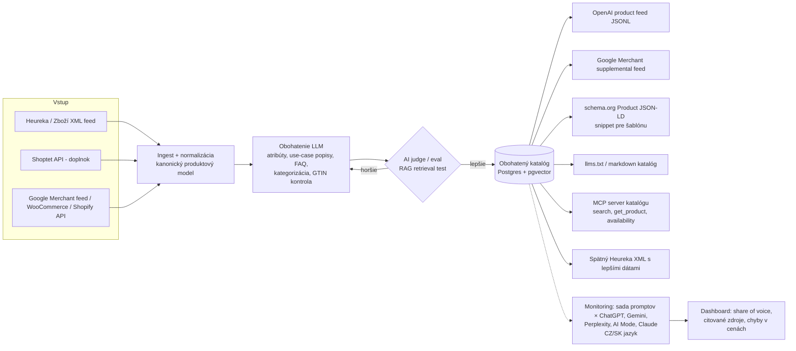

# Deep dive: E-shopy pripravené pre AI agentov (CZ/SK)

*Stav k 15. 10. 2026. Čo som neoveril, je označené „(neoverené)“. Moje vlastné odhady sú označené „(odhad)“.*

---

## 1. Čo to je a prečo teraz

„Agent-ready“ e-shop je obchod, ktorého produkty vie AI asistent (ChatGPT, Gemini / Google AI Mode, Perplexity, Claude, Copilot) **nájsť, pochopiť, porovnať a odporučiť** a v ďalšom kroku aj **kúpiť** cez štandardizovaný protokol. Prakticky ide o tri vrstvy: (a) **dáta**, teda čisté a obohatené produktové feedy v formátoch, ktoré AI platformy prijímajú (OpenAI product feed, Google Merchant Center, schema.org), (b) **viditeľnosť**, teda GEO/AEO (generative/answer engine optimization) a meranie, či a ako často AI daný obchod odporúča, a (c) **transakciu** cez protokoly ACP (OpenAI+Stripe), UCP/AP2 (Google), MCP servery a x402. Prečo teraz: Google spustil AI Mode v Česku aj na Slovensku v októbri 2025, OpenAI spustilo ChatGPT Shopping research v novembri 2025 a Košík.cz od mája 2026 predáva priamo v ChatGPT. Podľa štúdie českého startupu Ranketta (jún 2026) zároveň **~91 % z ~67 000 českých e-shopov sa v odpovediach AI asistentov vôbec neobjavuje**. Dopyt sa teda práve vytvára, ale väčšina obchodníkov ešte nič nerobí.

### Čo zaznelo na AI Engineer World's Fair 2026 (SF)

- **„The Death of Keyword Search and the Rise of Agent-Readable Catalogs“ (Nixon Dinh, PayPal):** PayPal testoval, ako obohatenie bežných katalógových dát zlepšuje to, ako AI produkty nachádza, chápe a radí. Postavili **RAG-based AI judge**, ktorým porovnávali rôzne prístupy k obohateniu, a našli **5 vzorov, ktoré konzistentne zlepšili AI discovery**. Pre nás je to priamy návod: obohatenie dát LLM sa dá merať evalom, nie len odhadovať. (Konkrétnych 5 vzorov popis talku neuvádza, treba pozrieť záznam.)
- **„The Agentic Commerce Stack“ (Ahnaf Prio, Best Buy):** Mapa vrstiev: **MCP** na prístup k nástrojom, **A2A** na koordináciu agentov, **ACP** (OpenAI) a **UCP** (Google) ako *dva konkurenčné* štandardy pre celý nákupný cyklus a **AP2** na platby. Talk otvorene hovorí, že sa to „ešte formuje“. Ukazuje aj referenčnú implementáciu s protocol inspectorom (tool calls, prechody úloh, checkout eventy).
- **„How PayPal Enterprise Payments handles agent-initiated payments across ChatGPT and Google AI Mode“ (Sam Parsons):** Tri cesty, všetky s potvrdením človekom (human-in-the-loop) a s atribúciou transakcie späť na AI platformu: (1) **ACP pre ChatGPT apps** (delegated payment tokens cez `complete_checkout`, validácia allowance, atribúcia cez `facilitator_details`), (2) **UCP + Google Pay pre AI Mode** (server-side `tokenizationSpecification`, single-use token z `androidPayCards`), (3) preview **MCP Apps inline checkout**, kde sa platobný formulár vykreslí priamo v chate a kartové údaje sa nikdy nedostanú do kontextu LLM.
- **„Teaching agents to pay“ (Anna Spysz, Stripe):** ACP + **Shared Payment Tokens** (tokeny viazané na povolenia). Talk pokrýva Stripe integráciu, ACP endpointy, chybové stavy a webhooky. Stripe stavia ACP ako bezpečný rámec, v ktorom agent nevidí platobné údaje.
- **„x402 isn't good (yet)“ (Jan Čurn, Apify, český founder):** Nikto nevie, ktorý protokol pre agentické platby vyhrá (x402, MPP, Skyfire…). x402 je najzrelší a má najväčší objem, ale ani nová schéma „upto“ nepodporuje skutočné usage-based pricing, pretože agent môže zdroje spotrebovať a potom nezaplatiť. Pre fyzický e-commerce je x402 zatiaľ irelevantný. Hodí sa na platby za API a dáta (machine-to-machine).
- **„The End of the Static Screen“ (Gus Iwanaga, commercetools):** UI už nie je vopred navrhnuté, ale generuje ho orchestrátor podľa zámeru zákazníka. Podmienkou je **composable backend, ktorý vystavuje skutočný „tool surface“**. Pre e-shop to znamená, že potrebuje API alebo MCP, nie len HTML.
- **„How We Got LLMs to Recommend Our Open Source Library“ (Christopher Burns):** Organické odporúčania od LLM sa dajú dosiahnuť za menej ako rok, bez platených umiestnení a pluginov, a to obsahom a dizajnom produktu, ktorý AI systémy „zoberú“. Potvrdzuje to GEO ako reálny distribučný kanál.
- Ďalšie talky v tracku (Jennifer Lee o HTTP 402, Circle/Arc o USDC nanopayments, AWS x402, Edge & Node, „Your Agent Just Authorized What?!“) sa sústreďujú na **M2M platby a autorizáciu**, nie na retail. Signál: platobná vrstva je fragmentovaná a pre malý e-shop to nie je miesto, kde dnes vzniká hodnota.

---

## 2. Stav protokolov a platforiem (k 15. 10. 2026)

| Čo | Stav | EU / CZ / SK |
|---|---|---|
| **ACP (Agentic Commerce Protocol)**, OpenAI + Stripe (podľa Stripe docs aj Meta) | Open spec. Prvé vydanie 29. 9. 2025 (Agentic Checkout + Delegate Payment). Posledná stabilná verzia 2026-04-17 (neoverené, iba sekundárny zdroj). | Spec je globálna. Reálne nasadenie checkoutu je naviazané na US. |
| **Instant Checkout v ChatGPT** | Spustený 9/2025 (US). **24. 3. 2026 OpenAI ustúpilo**: samostatný Instant Checkout „deprioritizovalo“, obchodníci používajú vlastný checkout a ChatGPT sa sústreďuje na discovery. Shopify uviedol, že ho integrovalo len ~12 obchodníkov. | V EU nikdy nespustený. |
| **ChatGPT Shopping (discovery) + product feed** | Feed spec: JSONL/CSV (alebo Google-kompatibilný TSV/CSV). Povinné polia `item_id, title, description, url, brand, seller_name, image_url, availability, price`. Flagy `is_eligible_search` / `is_eligible_checkout`. **Štandardný upload cieli na `["US"]`**, ďalšie trhy len po potvrdení OpenAI. | V CZ sa produkty zobrazujú **len organicky** (z webu) a feed je zatiaľ iba pre USA, registrovať sa dá z akejkoľvek krajiny (Průvodce podnikáním, 2. 6. 2026). commercetools uvádza, že onboarding vyžaduje US merchanta a US bankový účet. |
| **ChatGPT apps (Apps SDK / MCP)** | Funkčné. **Košík.cz** má od 28. 5. 2026 vlastnú app v ChatGPT (prihlásenie, košík, objednávka aj platba kartou v chate) a samostatný MCP server `mcp.kosik.cz`. Rohlík má MCP server, Slevomat a Suri majú ChatGPT apps. | **Funguje v CZ.** Toto je dnes reálna cesta k nákupu v chate. |
| **ChatGPT Ads** | Podľa Lengow spustené v EU-27 24. 8. 2026 (neoverené priamo u OpenAI). | Pravdepodobne aj CZ/SK (neoverené). |
| **UCP (Universal Commerce Protocol), Google** | Predstavené 11. 1. 2026 (NRF, partneri Shopify, Zalando, Walmart…). Checkout v AI Mode / Gemini. 5. 5. 2026 prvé „Buy“ v Search, 20. 5. multi-item košík a cart transfer. 6. 10. 2026 sa **UCP hub v Merchant Center** postupne otvára **iba vybraným US obchodníkom**. | CA/AU až 2027, UK „neskôr“, **EU bez dátumu**. |
| **AP2 (Agent Payments Protocol)** | Google platobná vrstva pod UCP (mandáty). | Bez EU dátumu (neoverené). |
| **Google AI Mode / AI Overviews** | AI Mode spustený v CZ aj SK 8. 10. 2025. | **Discovery funguje v CZ/SK.** Produktové dáta berie z Merchant Center a webu. Agentický checkout v CZ nie je. |
| **Perplexity Instant Buy (PayPal)** | Spustené 25. 11. 2025, iba US používatelia. | Nie. |
| **Shopify Agentic Storefronts** | Live od 24. 3. 2026, syndikácia Shopify Catalog do ChatGPT, Perplexity, Copilot, AI Mode. Pre US merchantov je to zapnuté defaultne. | Pre CZ Shopify obchody obmedzené (US focus). |
| **Stripe Agentic Commerce Suite / SPT** | Spustené 12/2025, Link wallet pre agentov 4/2026. Expanzia do DE (sponzorovaný článok). | EU dostupnosť SPT neoverená. |
| **x402** | Najväčší objem medzi M2M protokolmi, krypto (USDC). | Pre retail nepoužiteľné. |

**Záver sekcie:** V CZ/SK dnes **funguje discovery** (organické odporúčania v ChatGPT, AI Mode, Perplexity, Gemini) a **custom ChatGPT apps / MCP** (Košík). **Nefunguje** natívny agentický checkout (ACP Instant Checkout, UCP checkout ani Perplexity Instant Buy). Aj v US bol Instant Checkout komerčný prepadák. Hodnota pre CZ/SK e-shop je teda dnes v **dátach a viditeľnosti**. Transakčná vrstva je zatiaľ len opcia do budúcnosti.

---

## 3. CZ/SK trh

**Veľkosť**
- CZ e-commerce 2025: **~206 mld. Kč**, +6 % r/r, priemerná objednávka ~1 900 Kč (APEK + Heureka, Lupa/BusinessInfo).
- Počet CZ e-shopov: **~67 000 aktívnych** (dáta Shoptetu citované v štúdii Ranketta, resp. 67 305 ku koncu 2024 podľa Ceska-ecommerce). APEK uvádza „viac ako 40 000“, Heureka spolupracuje s „viac ako 50 000“. Metodiky sa líšia.
- Koncentrácia: ~dve desiatky najväčších hráčov robí polovicu tržieb, ~50 000 menších druhú polovicu (odhad Upgates, CzechCrunch). Top 100 e-shopov rástlo v 2025 o 14 %, trh o 6 %.
- SK: **13 900 aktívnych e-shopov** (Heureka) až **~16 000** (Upgates). Na Shoptete beží 7 600+ SK e-shopov (TASR, 7/2026).

**Platformy**
- **Shoptet**: ~**45 000** CZ+SK e-shopov (Lupa, 4/2026), zhruba tretina trhu. Obrat e-shopov na Shoptete v H1 2026 bol 325 mil. € (+20 %). REST API je dostupné **len pre doplnky** (partnerská zmluva) a len pre Premium obchody (podľa Violet docs). Doplnky sa predávajú cez doplnky.shoptet.cz.
- **Upgates**: lokalizovaná SaaS platforma CZ/SK, „viac ako tisíc“ obchodov (starší údaj, neoverené aktuálne).
- **Shopsys** (enterprise, open-source), **WooCommerce**, **PrestaShop**, **Shopify**, custom riešenia (Alza, Mall a pod.). Presné podiely na trhu som neoveril.

**Porovnávače a feedy**
- **Heureka** (CZ, SK, aj HU, RO…) a **Zboží.cz** (Seznam), ďalej **Pricemania** (SK), **Glami** (móda). Heureka XML (`SHOP/SHOPITEM`, `ITEM_ID, PRODUCTNAME, URL, IMGURL, PRICE_VAT, CATEGORYTEXT, EAN, PARAM, DELIVERY…`) je **de facto štandard**. Takmer každý CZ/SK e-shop ho už generuje, takže je to ideálny vstup pre náš produkt.
- AI tieto porovnávače reálne cituje: Allegro.cz 8,26 %, eBay 6,03 %, Alza.cz 4,69 %, **Zboží.cz 2,85 %**, **Heureka.cz 2,34 %** zo všetkých odporúčaní (Ranketta). Heureka tvrdí, že je 4. najcitovanejší český zdroj v ChatGPT a 2. v Perplexity.
- Prekrytie produktov z Google Shopping a z odporúčaní ChatGPT je len **13 %**, teda ChatGPT neberie dáta len z Google feedu.

**Platobné brány**
- **GoPay**: 18 000+ obchodníkov (Banky.cz, 5/2025), patrí do skupiny Worldline.
- **Comgate**: 15 000+ klientov (výročná správa 2024).
- **ThePay**, **Shoptet Pay**, **Stripe**, **PayU**, **Barion**, **PayPal**. Žiadna CZ brána zatiaľ nepodporuje ACP delegated payment ani UCP tokenizáciu (neoverené, nenašiel som žiadnu zmienku).

**Adopcia AI**: približne polovica Čechov používa AI ako nákupného poradcu (prieskum Heureka, 12/2025), iDnes (1/2026) uvádza tretinu. Podľa Upgates nasadzuje AI nástroje cielene len 20–30 % e-shopov a GEO rieši „minimum“.

---

## 4. Konkurencia

### Globálna

| Hráč | Čo robí | Cena | Čo nerobí (pre nás) |
|---|---|---|---|
| **Profound** | Enterprise AI visibility monitoring. | Starter 99 $/mes. (iba ChatGPT, 50 promptov), Growth 399 $/mes., ročná platba | Nerobí CZ jazyk/trh ani feedy. |
| **Peec AI** (Berlín) | Monitoring viditeľnosti značky v LLM. | Zdroje sa líšia: ~85–95 €/$ Starter až ~425–495 Advanced (neoverené) | Nerobí feed ani produktové dáta. |
| **Otterly.AI** | Monitoring, SMB-friendly. | Lite 29 $/mes. (15 promptov), Standard 189 $, Premium 489 $ | Nerobí feedy ani lokálne integrácie. |
| **Bluefish** (NY) | „Agentic Marketing Platform“ pre Fortune 500. 43 M$ Series B (4/2026), spolu 68 M$. | Enterprise | Nerieši SMB ani CEE. |
| **Shopify Catalog / Agentic Storefronts** | Natívna syndikácia do AI platforiem. | V cene Shopify | Iba Shopify a prakticky iba US. |
| **Feedonomics** (Agentic Catalog Exports, 27. 4. 2026), **Productsup** (OpenAI feed export), **Channable**, **Lengow**, **ChannelEngine** | Enterprise feed management s novými AI/ChatGPT exportmi. | Enterprise | Drahé, nemajú lokálny GEO monitoring. |
| WooCommerce pluginy (Agentabile, Respira ARC, „AI Merchant Feed“) | Generujú ACP/OpenAI JSONL feed. | Free / lacné | Bez obohatenia, monitoringu a podpory Shoptetu. |

### Lokálna CZ/SK

- **Mergado** (Brno): feed management, ktorý je v CZ de facto štandardom. **Od 1. 10. 2025 podporuje oficiálny ChatGPT feed formát.** Má aj **Mergado Pilot** (AI hromadné úpravy názvov a popisov vo feede). Ceny podľa PricingSaaS: Basic 11, Standard 22, Advanced 49 mesačne (mena neuvedená, pravdepodobne €). **Najsilnejší potenciálny konkurent a zároveň najlepší partner.** Nerobí monitoring viditeľnosti v AI odpovediach (podľa toho, čo som našiel).
- **Ranketta** (Brno, Vojtěch Oravec): AI visibility monitoring pre e-commerce značky (ChatGPT, Gemini, Perplexity, AI Mode, AIO), analýza zdrojov, sentiment, AI Copilot s odporúčaniami. **Pre-seed 1 M€ (11/2025, Lighthouse Ventures, Gi21).** Ceny nezverejnené. **Priamy konkurent v monitoringu**, ktorý má navyše dáta (1 M dopytov) a PR.
- **Stratt Labs**: predáva „Agent-Ready Feed“ za **4 990 Kč setup + 390 Kč/mes.** (podľa ich článku na MediaGuru, 5. 9. 2026). Firmu som nezávisle neoveril. Je to cenová kotva pre SMB.
- **Base.com (BaseLinker)**: CZ stránka o integrácii s „ChatGPT Agentic Checkout“. Dostupnosť pre CZ obchodníkov nie je uvedená.
- AI chatboty pre Shoptet (**Chaterimo**, **Jarabot**) importujú Shoptet XML feed, ale riešia chat na webe, nie viditeľnosť v externých AI.
- **Heureka** sa podľa expertov posúva od „zdroja trafficu“ k „dodávateľovi dát“ pre AI (Forbes CZ). Môže prísť s vlastným produktom (neoverené).

**Medzera:** Nikto v CZ/SK nespája **(1) Shoptet/Heureka feed → (2) LLM obohatenie s evalom → (3) výstupy pre všetky AI kanály → (4) meranie dopadu na viditeľnosť** do jedného lacného doplnku pre SMB. Mergado má časť (1–3), Ranketta má (4).

---

## 5. Ako to postaviť (technicky)

**Stack (návrh):**
- **Ingest:** Python (lxml streaming parser pre veľké XML), cron alebo webhook. Shoptet doplnok cez OAuth a partnerské API.
- **Dáta:** Postgres + pgvector, verzovanie produktových záznamov (diff pred a po obohatení).
- **Obohatenie:** lacný model (Claude Haiku / GPT mini triedy) cez batch API, štruktúrovaný JSON výstup podľa šablóny kategórie. Drahší model iba na eval. Prompt podľa kategórie (elektronika ≠ móda ≠ doplnky výživy).
- **Eval (PayPal prístup):** súbor syntetických konverzačných dopytov („tichá práčka do paneláku do 12 000 Kč“) → retrieval nad pôvodným vs. obohateným katalógom → LLM judge hodnotí relevanciu. Obohatenie publikovať až vtedy, keď eval potvrdí zlepšenie.
- **Výstupy:** generátory OpenAI JSONL (pripravený, aj keď je dnes iba pre US), Google Merchant supplemental feed (funguje v CZ a ovplyvňuje AI Mode), JSON-LD snippet, ktorý obchodník vloží do šablóny Shoptetu (cez doplnok to ide automaticky), MCP server (TypeScript MCP SDK, hosting Cloudflare Workers) s nástrojmi `search_products`, `get_product`, `check_availability` a `create_cart_link` (deeplink do košíka, nie platba).
- **Monitoring:** plánované dopyty cez API (OpenAI Responses s web search, Gemini s grounding, Perplexity Sonar API) a pre AI Mode / ChatGPT UI headless browser (Playwright). Parsovanie zmienok o doméne a produkte, citovaných zdrojov, cien.

**Čo je ťažké:**
1. **Merateľnosť:** výstupy LLM sú nedeterministické, API odpovede sa líšia od UI (hlavne ChatGPT Shopping a AI Mode). Treba veľa opakovaní a štatistiku, čiže to stojí peniaze.
2. **Kauzalita:** dokázať obchodníkovi, že „vďaka nám“ stúpla viditeľnosť, keď sa modely menia každý mesiac.
3. **Halucinácie pri obohatení:** vymyslený parameter (napr. hlučnosť práčky) je právne riziko (zavádzajúca obchodná praktika). Preto iba extrakcia a odvodenie z existujúcich dát, nikdy nevymýšľať čísla, a human review pri citlivých kategóriách.
4. **Prístup k API Shoptetu** vyžaduje partnerskú zmluvu a obchod s tarifou Premium. Lacnejšie tarify majú iba XML feedy.
5. **llms.txt** má slabý dopad: podľa Ahrefs 97 % llms.txt súborov nikdy nedostane request od AI. Nestavať na tom hodnotu.

---

## 6. MVP za 4–8 týždňov

**Scope (čo áno):**
- **Týždeň 1–2:** Ingest Heureka XML (URL feedu, žiadna integrácia) → kanonický model → **„AI readiness audit“**: chýbajúce EAN, slabé popisy, chýbajúce parametre, chýbajúce schema.org na produktovej stránke (crawl 50 URL), stav robots.txt pre GPTBot / OAI-SearchBot / PerplexityBot / Google-Extended.
- **Týždeň 2–4:** **Monitoring viditeľnosti** v češtine/slovenčine: 30–50 promptov na obchod, generovaných z jeho kategórií, cez ChatGPT, Gemini a Perplexity, raz týždenne, porovnanie s 3 konkurentmi. Report vo forme jednoduchého webu alebo PDF.
- **Týždeň 4–6:** **Obohatenie feedu** LLM + eval → výstup ako (a) vylepšený Heureka/Zboží XML, (b) Google Merchant supplemental feed, (c) JSON-LD snippet.
- **Týždeň 6–8:** Druhé meranie viditeľnosti po zmene, case study a až potom Shoptet doplnok (žiadosť o partnerstvo podať hneď v 1. týždni, schvaľovanie trvá).

**Čo vynechať:** checkout, ACP/UCP endpointy, x402, platby, MCP server pre všetkých (iba 1 pilot ako demo), vlastný dashboard s auth (stačí statický report), WooCommerce/Shopify konektory.

**Prví zákazníci (5–10):**
1. Z verejnej štúdie Ranketta/MediaGuru je jasné, kto je „neviditeľný“. Spraviť **zdarma mini-audit** (5 promptov a skóre feedu) pre 30–50 stredných e-shopov na Shoptete (obrat rádovo desiatky miliónov Kč) v kategóriách, kde AI odporúča často (elektronika, doplnky výživy, šport, domácnosť) a poslať ho ich majiteľom.
2. **Agentúry** (PPC/SEO, Shoptet partneri), ktoré potrebujú „GEO“ službu do portfólia: white-label report.
3. LinkedIn a CZ e-commerce komunita (Shoptet Fest, Mergado/Shoptet webináre, APEK): jeden dátový článok s vlastným meraním.
4. Pilot zadarmo alebo za symbolickú cenu výmenou za case study s číslami pred a po.

---

## 7. Biznis model a cenotvorba (odhad)

| Tier | Obsah | Cena (odhad) |
|---|---|---|
| Free audit | jednorazové skóre feedu + 5 promptov | 0 (lead gen) |
| **Starter (Shoptet doplnok)** | týždenný monitoring 30 promptov × 3 engine, readiness skóre, JSON-LD | 490–990 Kč/mes. |
| **Pro** | + obohatenie feedu (do 5 000 produktov), 100 promptov, konkurenti | 2 490–4 990 Kč/mes. |
| Agentúra / Enterprise | white-label, multi-client, MCP server, vlastné prompty | od 15 000 Kč/mes. |

Kotvy: Stratt Labs 390 Kč/mes. + 4 990 Kč setup, Otterly od 29 $, Profound od 99 $, Mergado Basic ~11 (mena neoverená).

**Unit economics (hrubý odhad):**
- Monitoring Pro: 100 promptov × 3 enginy × 4 týždne × 3 opakovania ≈ 3 600 dopytov/mes. Pri ~0,005–0,03 $ za dopyt s web search to vychádza na **~18–110 $/mes.** na zákazníka (odhad, závisí od cien API a od toho, či sa použije scraping). Toto je hlavná nákladová položka a treba ju zdieľať: rovnaké prompty v jednej kategórii slúžia viacerým zákazníkom.
- Obohatenie: 5 000 produktov × ~2 000 tokenov s batch API a malým modelom predstavuje rádovo jednotky až nízke desiatky $ jednorazovo (odhad).
- Pri cene Pro ~3 500 Kč (~140 €) je hrubá marža ~50–80 % (odhad). Starter pri 490 Kč je marginálny, ak sa monitoring nezdieľa medzi zákazníkmi.
- CAC: cez Shoptet doplnky a agentúry nízke stovky € (neoverené). Churn je pri „merať-ale-nevidieť-výsledok“ produktoch vysoký, preto treba ukázať akčné kroky, nie len grafy.

**Kanály:** (1) **Shoptet doplnky** (~45 000 obchodov, provízia neoverená), (2) **Upgates** marketplace, (3) **agentúry** (white-label), (4) **partnerstvo s Mergadom**: oni majú feedy a ChatGPT formát, my monitoring a eval obohatenia. Alternatívne nás môžu kúpiť alebo skopírovať. (5) Heureka/Zboží ako distribučný partner (teoreticky).

---

## 8. Riziká a otvorené otázky

1. **Transakčná vrstva v EU neexistuje:** ACP Instant Checkout bol 24. 3. 2026 v US stiahnutý, UCP je iba pre vybraných US merchantov a v EU bez dátumu, Perplexity Instant Buy funguje iba v US. Postaviť produkt na „agentic checkout pre CZ“ by dnes znamenalo predávať niečo, čo nejde zapnúť.
2. **OpenAI product feed je iba pre US** (štandardné uploady `["US"]`, US bankový účet). Pre CZ obchod je dnes hlavná páka organická viditeľnosť a Google Merchant Center.
3. **Platformové riziko:** Shoptet (alebo Heureka, Mergado) môže funkciu dodať natívne zadarmo. Shopify to už spravilo pre US. Shoptet API je navyše gated.
4. **Konkurencia s kapitálom:** Ranketta má 1 M€ a rovnaký trh. Mergado má distribúciu a ChatGPT formát od 10/2025.
5. **Merateľnosť a ROI:** AI traffic je zatiaľ „niekoľko percent“ návštev a pri Košíku „promile“ objednávok. Ochota SMB platiť za GEO nie je overená.
6. **Regulácia:** AI Act (povinnosti pre systémy s obmedzeným rizikom od 2. 8. 2026), zákon o ochrane spotrebiteľa (obsah generovaný AI nesmie zavádzať).
7. **Otvorené:** Kedy príde ChatGPT feed / UCP do EU? Bude Google Merchant Center v CZ kŕmiť Gemini shopping? Pustí Shoptet externé MCP? Aká je provízia Shoptet doplnkov?

---

## 9. Odporúčanie

**Robiť, ale úzko a ako „data + visibility“, nie ako „agentic checkout“.** Wedge: *„Zistite, či vás AI odporúča, a opravte si feed tak, aby áno.“* Vstup cez Heureka XML (ktorý majú všetci), výstup do kanálov, ktoré v CZ/SK reálne fungujú (Google Merchant, schema.org, porovnávače), a meranie efektu. Protokoly ACP/UCP/MCP držať ako roadmapu: keď sa EU otvorí, budeme mať obohatený katalóg pripravený na export jedným klikom. MCP/ChatGPT app à la Košík ponúkať iba väčším obchodom ako custom projekt. Pred commitom si treba poctivo zodpovedať, či sa dá odlíšiť od Ranketty (monitoring) a Mergada (feedy). Najpravdepodobnejšia diferenciácia je **eval-driven obohatenie s dokázaným dopadom + Shoptet-native distribúcia + nízka SMB cena**.

**5 konkrétnych ďalších krokov:**
1. **Tento týždeň:** Napísať na api@shoptet.cz / partnerský formulár (developers.shoptet.cz) a zistiť podmienky doplnkov, províziu a prístup k API.
2. **Do 2 týždňov:** Zmerať 20 e-shopov (3 kategórie × 30 CZ promptov × ChatGPT/Gemini/Perplexity) a overiť, či vieme reprodukovať čísla Ranketty a koľko nás meranie stojí na obchod.
3. **Do 3 týždňov:** Prototyp obohatenia na 2 reálnych Heureka feedoch + RAG judge eval (podľa PayPal talku). Zistiť, či obohatenie merateľne zlepší retrieval.
4. **Do 4 týždňov:** 10 discovery hovorov (5 e-shopov 10–200 mil. Kč obrat, 3 agentúry, 1× Mergado, 1× Heureka) s otázkou „platili by ste 1–5 tis. Kč/mes. a za čo konkrétne?“.
5. **Do 6 týždňov:** 3 platené piloty, prvá case study pred/po a rozhodnutie go/no-go podľa toho, či sa viditeľnosť po zmene feedu pohne.

---

## 10. Zdroje

**Konferencia**
- Program AI Engineer World's Fair 2026: lokálny súbor `conference/sessions.json`

**Protokoly a platformy**
- [OpenAI – Buy it in ChatGPT (Instant Checkout + ACP)](https://openai.com/sk-SK/index/buy-it-in-chatgpt/)
- [OpenAI – ChatGPT shopping research (CZ)](https://openai.com/cs-CZ/index/chatgpt-shopping-research/)
- [OpenAI Commerce – Product feed spec](https://developers.openai.com/commerce/specs/feed)
- [OpenAI Commerce – Key concepts](https://developers.openai.com/commerce/guides/key-concepts)
- [Stripe – Agentic Commerce Protocol docs](https://docs.stripe.com/agentic-commerce/protocols/acp)
- [agenticcommerce.dev – changelog](https://agenticcommerce.dev/docs/changelog)
- [eco.com – ACP explained](https://eco.com/support/en/articles/14845478-acp-agentic-commerce-protocol-explained)
- [Retail Systems – OpenAI pivot from Instant Checkout](https://retail-systems.com/rs/OpenAI_to_pivot_from_Instant_Checkout_ChatGPT_feature_months_after_launch.php)
- [Storyboard18 – OpenAI scales back ChatGPT shopping](https://storyboard18.com/digital/openai-reduces-chatgpt-shopping-focus-shifts-to-product-discovery-93192.html)
- [Mezha – OpenAI pauses Instant Checkout](https://mezha.net/eng/bukvy/openai_pauses_instant/)
- [Ecomcrew – OpenAI pulls back on Instant Checkout](https://www.ecomcrew.com/openai-pulls-back-on-chatgpt-instant-checkout/)
- [Digital Commerce 360 – OpenAI expands agentic commerce push (2/2026)](https://www.digitalcommerce360.com/2026/02/16/openai-expands-agentic-commerce-push/)
- [commercetools docs – OpenAI AI hub](https://docs.commercetools.com/agentic-commerce/ai-hub/openai/overview)
- [Lengow – ChatGPT feeds & ads](https://www.lengow.com/integrations/chatgpt)
- [PPC Land – UCP hub, Canada/Australia 2027](https://ppc.land/canada-and-australia-face-2027-wait-for-googles-merchant-center-ucp-hub/)
- [Google – UCP developer docs](https://developers.google.com/merchant/ucp?hl=ar)
- [Google – UCP FAQ](https://developers.google.com/merchant/ucp/faq?hl=pt)
- [FashionNetwork – Google rolls out UCP](https://in.fashionnetwork.com/news/Google-rolls-out-its-universal-standard-for-ai-powered-commerce,1797227.html)
- [PayPal newsroom – Perplexity Instant Buy](https://newsroom.paypal-corp.com/2025-11-PayPal-and-Perplexity-Launch-Instant-Buy)
- [Ringly – Agentic storefront on Shopify](https://www.ringly.io/blog/agentic-storefront-shopify)
- [Ringly – AI sales channels for Shopify](https://www.ringly.io/blog/ai-sales-channel-shopify)
- [Fintech Global – Stripe Agentic Commerce Suite](https://fintech.global/2025/12/17/stripe-launches-agentic-commerce-suite-for-ai-sales/)
- [RisingWave – Stripe Shared Payment Tokens](https://risingwave.com/blog/stripe-shared-payment-tokens-spt-explained/)
- [retail-news.de – Stripe Agentic Commerce Suite Deutschland](https://retail-news.de/stripe-agentic-commerce-suite-deutschland/)
- [Lupa – Google spúšťa v Česku AI Mode](https://www.lupa.cz/clanky/google-spousti-v-cesku-ai-mode-vyhledavani-uz-nikdy-nebude-stejne/)
- [Nasdaq – Feedonomics Agentic Catalog Exports](https://www.nasdaq.com/press-release/feedonomics-unlocks-agentic-discovery-agentic-catalog-exports-2026-04-27)
- [Productsup – OpenAI API product feed export](https://help.productsup.com/docs/help-center/export-data-feeds/add-export/add-openai-api-product-feed-export)

**CZ/SK trh**
- [Lupa – Nákup na Košíku priamo v ChatGPT](https://www.lupa.cz/aktuality/nakup-na-kosiku-udelate-primo-v-chatgpt-do-roku-2030-firma-ocekava-15-objednavek-od-ai/)
- [Lupa – 9 z 10 českých e-shopov pre AI neexistuje (Ranketta)](https://www.lupa.cz/clanky/umela-inteligence-si-pri-doporucovvani-uzivatelum-vybira-sve-favority-devet-z-deseti-ceskych-e-shopu-pro-ni-neexistuje/)
- [MediaGuru – 91 % českých e-shopov pre AI asistentov neexistuje](https://www.mediaguru.cz/91-ceskych-e-shopu-pro-ai-asistenty-neexistuje)
- [Průvodce podnikáním – ChatGPT pre zvýšenie predajov (GEO)](https://www.pruvodcepodnikanim.cz/clanek/jak-vyuzit-chatgpt-pro-zvyseni-prodeju-od-geo-az-po-reklamy/)
- [Lupa – české e-shopy 2025 cez 200 mld.](https://www.lupa.cz/aktuality/ceske-e-shopy-loni-podruhe-v-historii-utrzily-pres-200-miliard-trh-se-po-covidu-vratil-k-rustu/)
- [BusinessInfo – obraty e-shopov +6 %](https://www.businessinfo.cz/clanky/ceska-e-commerce-se-dari-obraty-e-shopu-loni-narostly-o-sest-procent/)
- [CzechCrunch – takmer 50 tisíc e-shopov](https://cc.cz/v-cesku-funguje-bezmala-50-tisic-e-shopu-prehledne-ukazujeme-jak-si-takovy-pocet-vubec-predstavit/)
- [CzechCrunch – najväčšie e-shopy 2026](https://cc.cz/ecommerce-2026/)
- [Lupa – Shoptet (téma)](https://www.lupa.cz/n/shoptet/)
- [TASR – Rok 2026 pre slovenské e-shopy](https://www.teraz.sk/ekonomika/rok-2026-je-pre-slovenske-e-shopy-pozit/980905-clanok.html)
- [TASR – Heureka: e-commerce na Slovensku](https://www.teraz.sk/ekonomika/heureka-e-commerce-na-slovensku-vlani-n/848854-clanok.html)
- [Právne noviny – 700 nových SK e-shopov](https://pravnenoviny.sk/slovensky-e-commerce-rastie-700-novych-e-shopov-za-pol-roka/)
- [CzechCrunch – Upgates](https://cc.cz/pronajem-e-shopu-jako-nejrychlejsi-vstup-do-e-commerce-ceska-sluzba-upgates-pohani-pres-tisic-online-obchodu/)
- [Shoptet developers – základné informácie](https://developers.shoptet.cz/zakladni-informace/)
- [Shoptet developers – dokumentácia](https://developers.shoptet.cz/dokumentace/)
- [Violet docs – Shoptet](https://docs.violet.io/ecom-platforms/shoptet)
- [Banky.cz – GoPay](https://www.banky.cz/clanky/recenze-platebni-brany-gopay-nejpouzivanejsi-platebni-brany-v-cr/)
- [Comgate – výročná správa 2024](https://www.comgate.cz/files/vz-cg-2024.pdf)
- [Forbes CZ – Shoptet spúšťa platobnú bránu](https://forbes.cz/shoptet-chce-konkurovat-paypal-a-gopay-spousti-vlastni-platebni-branu/)
- [Mergado help – Heureka feed chyby](https://help.mergado.com/en/mergado-editor/advertising-channels-and-listings/heureka/how-to-fix-feed-errors-and-prevent-heureka-from-rejecting-products/)
- [Pricefy – Heureka feed](https://www.pricefy.io/feed-channels/heureka)
- [Newstream – Heureka a AI Act](https://www.newstream.cz/zpravy-z-firem/e-shopy-maji-pouze-par-dni-na-splneni-pozadavku-ai-actu-mnoho-z-nich-ale-nevi-co-presne-to-znamena)
- [Forbes CZ – Nakupovanie už nikdy nebude rovnaké](https://forbes.cz/nakupovani-uz-nikdy-nebude-stejne-inteligentni-agenti-prevezmou-vyber-i-rozhodovani/)

**Konkurencia**
- [Mergado news – ChatGPT Shopping](https://www.mergado.com/category/mergado-news)
- [Mergado Pilot](https://store.mergado.com/detail/mergadopilot/)
- [PricingSaaS – Mergado ceny](https://pricingsaas.com/companies/mergado)
- [Tech.eu – Ranketta 1 M€](https://tech.eu/2025/11/27/ranketta-receives-eur1m-to-improve-ecommerce-brand-performance-in-ai-search/)
- [Vestbee – Ranketta](https://vestbee.com/blog/articles/ranketta-secures-1-m)
- [Base.com – integrácia ChatGPT Agentic Checkout](https://base.com/cs-CZ/integrace/chatgpt/)
- [Ryze – AI visibility tools pricing 2026](https://www.get-ryze.ai/blog/ai-visibility-tools-pricing-compared-2026)
- [Alhena – Profound alternatives](https://alhena.ai/blog/profound-alternatives/)
- [Piabo – Otterly alternatives](https://munich2026.piabo.net/comparisons/otterly-alternatives)
- [Piabo – Peec AI alternatives](https://munich2026.piabo.net/comparisons/peec-ai-alternatives)
- [Pulse 2.0 – Bluefish 43 M$ Series B](https://pulse2.com/bluefish-43-million-series-b-fuels-expansion-of-agentic-marketing-platform/amp/)
- [Agentabile (WordPress plugin)](https://fa.wordpress.org/plugins/?p=345458)
- [Respira ARC – Agent-Ready Commerce](https://docs.respira.press/docs/woocommerce/agent-ready-commerce)
- [Chaterimo – AI chatbot pre Shoptet](https://www.chaterimo.com/cs/blog/ai-chatbot-shoptet/)
- [Jarabot – Shoptet integrácia](https://jarabot.com/en/integration/shoptet)
