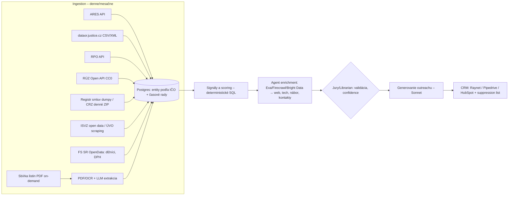

# Deep dive: GTM engineering na CEE dátach – „Clay pre CEE"

*Stav k 15. 10. 2026. Čo je overené webom alebo živým volaním API, je uvedené so zdrojom. Čo overené nie je, je označené „(neoverené)". Odhady nákladov sú naše vlastné výpočty z cenníkov, nie zmerané hodnoty.*

---

## 1. Čo to je a prečo práve teraz

**Produkt:** obchodník alebo marketér si zadá ICP, napríklad „výrobné s.r.o. v Morav­skoslezskom kraji, tržby 2–20 mil. €, rast nad 15 %, nábor v IT". Nástroj z verejných registrov CZ/SK zostaví zoznam firiem podľa IČO. AI agenti ho potom obohatia o web, kontakty, technológie, financie a signály (nábor, rast, tendre, zmluvy so štátom, insolvencie). Nakoniec vygenerujú personalizovaný outreach a pošlú ho do CRM (Pipedrive, HubSpot, Raynet).

**Prečo teraz:**
- Na SK sú účtovné závierky dostupné ako **štruktúrované JSON dáta pod licenciou CC0** (RÚZ Open API). V CZ sú len ako PDF v sbírke listin, takže tam je parsing závierok cez LLM/OCR reálna technická bariéra a zároveň vodný príkop proti konkurencii.
- Cena LLM spracovania prudko klesla. Claude Haiku 5.5 stojí $0,10 / $0,50 za 1M tokenov vstup/výstup, Sonnet 5.5 $2 / $10 a Batch API dáva 50 % zľavu (cenník Anthropic, cache k 6. 10. 2026). Obohatenie jednej firmy agentom tak vychádza na centy.
- Clay vytvoril kategóriu „GTM engineer". Na globálne nástroje (Clay, Apollo) však CZ/SK firmy narážajú: majú slabé pokrytie malých lokálnych firiem, nevedia čítať české/slovenské registre a ich ceny sú v USD.

### Čo zaznelo na AI Engineer World's Fair 2026 (track „AI in GTM", deň 3)
*Zdroj: popisy talkov v `conference/sessions.json`. Ide o abstrakty, nie o prepisy.*

- **Clay – Everett Berry, „GTM Engineering: The Technical Bits":** GTM engineering je v skutočnosti inštalatérstvo: enrichment pipelines, klasifikácia dát agentmi, **identity resolution** a premena neštruktúrovaných webových dát na **čisté, deterministické CRM polia**. *Pre nás:* IČO je dar, lebo identity resolution máme na 80 % vyriešenú zadarmo.
- **Ramp – Arman Vaziri, „The Building Blocks of GTM Orchestration":** Ramp si postavil vlastný revenue stack. Tvorí ho CDP, ktoré denne spracuje milióny interných, externých a CRM záznamov, a jednotná akčná vrstva s agentmi priamo vo workflow obchodníkov. **Na tejto vrstve beží viac ako 80 % sales workflowov.** *Pre nás:* hodnotu netvoria dáta samotné, ale to, že obchodník nemusí preskakovať medzi 10 systémami.
- **Cloudflare – Justin Joyce, „How AI Agents Let GTM Teams Scale":** agenti **nikdy nesiahajú na surové dáta**. Čísla počíta deterministická vrstva, agenti píšu naratív a multi-agentová pipeline premení každý segment na zoradené signály. Dôležitá je aj kurátorská práca so skills a adopcia. *Pre nás:* finančné metriky z registrov počítať v SQL, LLM používať len na interpretáciu a text.
- **Exa – Jeffrey Wang, „Knowledge Systems: The New GTM Stack":** Exa nasadila vlastný knowledge graph (index webu) na celý svoj GTM, od outboundu po interných copilotov.
- **Exa – Will Bryk, „The Search Engine for the Agentic Web":** agent robí desiatky sekvenčných vyhľadávaní, preto rozhoduje latencia (pod 200 ms) a štruktúrovaný výstup. Bryk tvrdí, že existujúce benchmarky agentického vyhľadávania sú nedostatočné.
- **Snowflake – Sait Izmit, „Building GTM AI Agents: Lessons from Deploying to 6,000 Users":** interný GTM asistent pre viac ako 6 000 zamestnancov, ktorý zodpovedal viac ako 1 milión otázok. Témy: scoping MVP, kvalita vs. pokrytie, MCP.
- **Notion – Flora Liu, „AI in GTM at Notion":** podľa nej treba explicitne rozhodnúť, čo vlastní AI a čo človek. Najdôležitejšie výhry (rýchlosť, adopcia) sa podľa nej nikdy neukážu v grafe tržieb.
- **Upside – Alex Bauer, „How Juries and Librarians Can Solve GTM's AI Trust Problem":** AI nevie povedať „nie som si istý". Upside preto nasadzuje **„librarian"**, s ktorým sa každý agent poradí pred akciou, a model **jury + judge** pre subjektívne rozhodnutia. Treba tiež vedieť, kedy je model na úlohu príliš slabý. *Pre nás:* ICP fit a „je toto ten istý človek/firma" riešiť porotou modelov.
- **Acrew Capital – Aliisa Rosenthal (ex-OpenAI), „Reverse-Engineering the AI Buyer":** pilot nie je deal. Dôvera a change management sa musia navrhovať od prvého dňa.
- **Web dáta:** **Bright Data** (Yohan Raju) mal workshop o MCP serveri a scraping API pre agentov. **Oxylabs** (Giedrius Steimantas, „The Missing Layer in Agentic AI") hovoril o troch primitívach každého produkčného agenta: browser, rýchle search API a univerzálny scraper. Agenti podľa neho padajú na blokovaní, rate limitoch a CAPTCHA. Ďalší talk Oxylabs (Patricija Žemaitytė) bol o web-data infraštruktúre pre AI. **Firecrawl** sa objavil ako zdroj kurátorskej knowledge base (Cody Menefee) a ako adoptér protokolu auth.md (WorkOS). **Browserbase** (Paul Klein IV) uviedol, že agenti strávia v ich browseroch milióny hodín mesačne, okrem iných pre Ramp.

---

## 2. Dátové zdroje CZ/SK

| Zdroj | Čo obsahuje | Prístup / formát | Licencia / cena | Stav overenia |
|---|---|---|---|---|
| **ARES** (CZ, MF ČR) | Agregácia zdrojových registrov (VR, RES, RŽP…) podľa IČO | REST JSON, `ares.gov.cz/ekonomicke-subjekty-v-be/rest/…` | Zadarmo. MF si vyhradzuje blokovanie pri **viac ako 500 dotazoch/min**, presné per-user limity nezverejňuje. Údaje majú „len informatívny charakter". | Endpoint overený živým volaním (HTTP 200) |
| **Veřejný rejstřík – open data** (CZ, MSp) | Výpisy podľa právnej formy, súdu a roka: statutári, spoločníci, kapitál, predmet činnosti, insolvencia, exekúcie | `dataor.justice.cz`, CKAN API, CSV/XML (aj .gz) | Zadarmo. **Licencia v metadátach chýba** (neoverené) | Overené (package_list, napr. `sro-actual-praha-2026`) |
| **Sbírka listin** (CZ) | **Účtovné závierky, výročné správy v PDF**, často skeny | Len web `or.justice.cz`, v open data sadách nie je | Zadarmo na čítanie. Hromadné sťahovanie nie je oficiálne podporované (neoverené) | Overené, že dataset obsahuje len výpis, nie listiny |
| **RES** (ČSÚ) | NACE, počet zamestnancov (kategória) | Cez ARES | Zadarmo | Čiastočne (cez ARES) |
| **Živnostenský rejstřík** (CZ) | Živnosti | Cez ARES (zdroj RŽP) | Zadarmo | Čiastočne |
| **ISIR – insolvenčný rejstřík** (CZ) | Insolvencie | Web eISIR + strojová webová služba pre automatizované spracovanie | Zadarmo. Aktuálne WSDL/podmienky (neoverené) | Čiastočne |
| **Registr smluv** (CZ) | Zmluvy štátu nad 50 tis. Kč (dodávateľ podľa IČO) | **Mesačné XML dumpy** `data.smlouvy.gov.cz/dump_RRRR_MM.xml` | Zadarmo | Overené (dumpy aktualizované v 10/2026) |
| **Veřejné zakázky – NEN/ISVZ** (CZ) | Tendre, víťazi | `isvz.nipez.cz/opendata`: „pôvodné" do 01/2024 (Věstník, XML) a „nové" od 02/2024 (Registr veřejných zakázek). API k NEN na podpora.nipez.cz | Zadarmo, licencia (neoverené) | Overené (stránka) |
| **Hlídač státu** (CZ, NGO) | Zjednotené zmluvy, dotácie, firmy, politici | REST API + MCP server, token po registrácii | Licencia dát (neoverené). Komerčné použitie treba dohodnúť | Overená existencia API/MCP |
| **RPO** (SK, ŠÚ SR) | Právnické osoby, podnikatelia, OVM. Historizované názvy a adresy | **REST JSON `api.statistics.sk/rpo/v1/search?identifier=IČO`** | Zadarmo, licencia (neoverené) | Overené živým volaním |
| **RÚZ** (SK, MF SR) | **Účtovné závierky ako štruktúrované výkazy** (súvaha, VZaS po riadkoch), výročné správy, prílohy | **Open API v2.5, JSON**, inkrementálne podľa `zmenene-od`, až 10 000 ID na stránku | **CC0** | Overené (dokumentácia + živé volanie) |
| **ORSR** (SK) | Obchodný register | Web `orsr.sk` bez oficiálneho API. MS SR má pilotné OpenAPI (Swagger) s nejasným rozsahom | Zadarmo | Čiastočne. Pre ORSR (neoverené) |
| **ŽR SR** | Živnosti | `zrsr.sk` (web). API (neoverené). Živnostníkov pokrýva aj RPO | – | Neoverené |
| **Finančná správa SR – OpenData** | **Zoznam daňových dlžníkov, platitelia DPH, dôvody na zrušenie registrácie DPH** (denná aktualizácia), ďalšie datasety | `opendata.financnasprava.sk`, API kľúč, **limit 1 000 req/hod** (dá sa navýšiť) | Zadarmo | Overené |
| **Index daňovej spoľahlivosti** (SK) | Hodnotenie subjektov | Verejne sú len štatistiky. Hodnoty pre jednotlivé subjekty uvádza FinStat (neoverené) | – | Čiastočne |
| **CRZ** (SK) | Zmluvy štátu | **Denné exporty ZIP** `crz.gov.sk/export/RRRR-MM-DD.zip` (pre 1. 10. 2026 HTTP 200, cca 450 kB) | Zadarmo, licencia (neoverené) | Overené |
| **ÚVO – Vestník** (SK) | Tendre | Oficiálne API sa nepodarilo nájsť. Existujú komerčné scrapery (Apify). Nadlimitné tendre sú v TED a EU Public Procurement Data Space | – | Oficiálne API (neoverené) |
| **FinStat** (SK, komerčný) | Financie, dlhy, exekúcie, CZ dáta, API | API s kreditmi (napr. 1,60 € za akciu v registri exekúcií) | Platené | Čiastočne |
| **CZ DPH – nespoľahliví platcovia** | – | Webová služba ADIS (neoverené) | Zadarmo | Neoverené |

**Kľúčový záver:** na SK sa dá „FinStat-level" finančný profil postaviť zadarmo z RÚZ (CC0) a RPO. V CZ sú financie iba v PDF, preto **pipeline na parsing závierok zo sbírky listin je naša najväčšia technická výhoda** a zároveň najväčšie riziko (právne aj kvalitatívne).

---

## 3. Konkurencia

| Hráč | Čo má | Cena | Slabina pre CZ/SK |
|---|---|---|---|
| **Clay** | Waterfall enrichment, 100+ providerov, AI agent „Claygent", tabuľky | Free, **Launch od $185/mes** (2 500 data credits + 15 000 actions), **Growth od $495/mes**, Enterprise s mediánom cca $30 tis./rok (zdroje tretích strán k 2026) | Nevie čítať CZ/SK registre, nemá IČO logiku, slabé pokrytie malých firiem, platí sa v USD |
| **Apollo** | Kontaktná DB + sekvencie | Free/Basic/Professional/Custom, kreditový model. Ceny za seat (neoverené) | Slabé pokrytie CEE SMB (neoverené) |
| **Cognism, Lusha** | Kontakty, mobilné čísla, EU/GDPR positioning | Na dopyt (neoverené) | Malé CZ/SK firmy (neoverené) |
| **Dealfront** (Leadfeeder + Echobot) | Identifikácia návštevníkov webu, sales intelligence silná v DACH | Leadfeeder od cca €/$99/mes. Echobot moduly len na ponuku, odhady $1,5–3,75 tis./mes od konkurenta (neoverené) | Drahé, DACH-centrické. CZ/SK hĺbka (neoverené) |
| **Merk.cz** (Imper) | DB CZ firiem, lookalike podľa IČO, API do CRM, overené kontakty, risk rating | 7-dňový trial. Cenník (neoverené) | Najbližší CZ konkurent. AI agenti a outreach (neoverené) |
| **FinStat** (SK) | Financie, dlhy, exekúcie, insolvencie, CZ dáta, API, datasety, HitHorizons (EU) | Premium/Elite/Ultimate, API na kredity | Dátový portál, nie GTM workflow |
| **Leadspicker** (CZ) | AI SDR, email a LinkedIn outreach, routines, MCP | **Explorer €199, Growth €479, Scale €1 599/mes**, kreditový model (1 kredit = 0,01 €) | Silný v outreachu. Hĺbka CZ/SK registrov (neoverené) |
| **Cribis, Dun & Bradstreet CZ/SK** (ex Bisnode) | Kreditné dáta, viac ako 10 mil. subjektov | Na dopyt. Cribis zakazuje strojové sťahovanie | Risk/compliance, nie outbound |
| **Kurzy.cz, Index podnikatele, firmy.cz** | Katalógy a výpisy, SEO | Freemium (neoverené) | Žiadny workflow |
| **Hlídač státu** | Open data o štáte | Zadarmo (NGO) | Zdroj, nie konkurent |
| **Foaf.sk** | SK firmy, finančné kategórie | (neoverené) | Katalóg |
| **Lokálne AI GTM startupy** | Funded CZ/SK „AI SDR" startup sme nenašli. Existujú agentúry (napr. DevCommX, Bratislava) | – | Medzera |

**Medzera:** nikto nespája (a) **registre podľa IČO**, (b) **AI extrakciu z PDF závierok CZ**, (c) **signály zo štátnych zmlúv a tendrov** a (d) **agentový web enrichment + outreach + zápis do Raynetu/Pipedrive** v jednom „Clay-like" workflow, za cenu v EUR a s GDPR/ePrivacy guardrails pre CZ/SK.

---

## 4. GDPR a právo (kritické)

> Toto nie je právna rada. Pred spustením treba posudok advokáta (odhadom 1–2 tis. € (neoverené)).

### 4.1 GDPR – kontakty fyzických osôb v B2B
- Meno a pracovný e-mail konateľa či zamestnanca sú **osobné údaje**, aj keď sú v obchodnom registri.
- **Právny základ:** oprávnený záujem (čl. 6 ods. 1 písm. f) je pri B2B prospectingu reálny. SDEÚ v **C-621/22 (KNLTB, 4. 10. 2024)** potvrdil, že aj čisto komerčný záujem môže byť oprávneným záujmom, ak prejde testom nevyhnutnosti a vyvažovania vrátane „primeraného očakávania" subjektu. EDPB Guidelines 1/2024 (draft 10/2024, finálny stav (neoverené)).
- **Prakticky:** pre každý typ kontaktu treba spraviť **LIA (Legitimate Interest Assessment)**, splniť **informačnú povinnosť podľa čl. 14** do 1 mesiaca od získania údajov (najneskôr pri prvom kontakte), dať **právo namietať**, zaviesť **suppression list** naprieč zákazníkmi, minimalizáciu dát (žiadne súkromné e-maily ani mobily) a retenčnú politiku.
- **Naša rola:** pri vlastnej DB kontaktov sme **samostatný prevádzkovateľ** (ako FinStat, ktorý to výslovne uvádza). Zákazník je ďalší prevádzkovateľ. Pri enrichmente zákazníkových dát sme sprostredkovateľ s DPA.
- **Bezpečnejšie MVP:** **neposkytovať vlastnú databázu e-mailov osôb**. Firmy a role brať z registrov, osobné e-maily hľadať on-demand na verejnom webe firmy (alebo cez licencovaného providera) v mene zákazníka.

### 4.2 CZ – zákon 480/2004 Sb., § 7 (overené znenie)
- **§ 7 ods. 2:** elektronický kontakt možno použiť na obchodné oznámenia **len s predchádzajúcim súhlasom**. Zákon nerozlišuje B2B a B2C.
- **§ 7 ods. 3:** výnimka len pre **vlastných zákazníkov** a podobné produkty, s opt-outom v každej správe.
- **§ 7 ods. 4:** správa musí byť označená ako obchodné oznámenie, nesmie skrývať odosielateľa a musí obsahovať platnú adresu na odhlásenie.
- **Výklad ÚOOÚ:** zverejnenie v obchodnom registri **nie je súhlas**. Kúpené databázy nesplňujú podmienku informovaného súhlasu. Porušením je **už jedna** nevyžiadaná správa. ÚOOÚ v roku 2024 udeľoval pokuty za e-maily bez preukázateľného súhlasu.
- **Zákon o digitální ekonomice** (sněmovní tisk 69) má 480/2004 zrušiť a nahradiť. K 15. 10. 2026 je v **2. čítaní** a je zaradený na 34. schôdzu od 13. 10. 2026. Ešte nie je vo Sbierke. Návrh podľa dôvodovej správy zakazuje posielať nevyžiadané oznámenia na kontakty nepriradené konkrétnej osobe (info@). Finálne znenie (neoverené).
- **Prakticky CZ:** cold e-mail s obchodnou ponukou je **vysoko rizikový**. Bezpečnejšie cesty: (1) **LinkedIn / telefonát človekom** (telefonovanie nespadá pod § 7 480/2004, ale GDPR áno), (2) **prvý e-mail bez obchodnej ponuky**, ktorý žiada o súhlas alebo o kontakt na správnu osobu (stále šedá zóna, ÚOOÚ to môže posúdiť ako obchodné oznámenie (neoverené)), (3) **warm signály**: inbound, eventy, odporúčania. Produkt by mal mať **„CZ compliance mód"**, ktorý generuje skôr LinkedIn a call skripty než hromadné maily.

### 4.3 SK – zákon 452/2021 Z. z., § 116 (overené znenie)
- **Ods. 3:** e-mail na priamy marketing len s predchádzajúcim preukázateľným súhlasom.
- **Ods. 15 – kľúčová výnimka:** súhlas sa **nevyžaduje**, ak ide o *„priamy marketing adresovaný na **zverejnené kontaktné údaje** účastníka alebo užívateľa, ktorý je **fyzickou osobou podnikateľom alebo právnickou osobou**"*. Vždy je povinný jednoduchý bezplatný opt-out v každej správe a známa totožnosť a adresa odosielateľa.
- **Ods. 12:** pri volaniach na zverejnené kontakty podnikateľov a PO sa nevyžaduje špeciálne „marketingové" číslo.
- **Sankcie:** ÚRSO, od 200 € do 5 % obratu (podľa podnikajte.sk).
- **Prakticky SK:** cold e-mail na **firemné kontakty zverejnené samotnou firmou** (web, info@, sales@) je dovolený s opt-outom. E-mail **konkrétneho zamestnanca** dohľadaný inde je šedá zóna: ide o kontakt právnickej osoby, alebo osobný údaj zamestnanca? Popri tom stále platí GDPR (LIA, čl. 14).
- **Strategický dôsledok:** **SK je lepší štartovací trh pre outbound mód**, CZ pre data/enrichment a LinkedIn/call mód.

---

## 5. Ako to postaviť technicky

**Komponenty:**
1. **Ingestion:** Python workers (Prefect/Temporal) a Postgres. ARES, RPO a RÚZ inkrementálne, **rešpektovať limity** (ARES < 500/min, FS SR 1 000/h). Justice open data plným dumpom ročne a „actual" sadami priebežne.
2. **Entity resolution:** IČO ako primárny kľúč (CZ 8 číslic s nulami vpredu, SK 8 číslic, kolízie CZ/SK riešiť prefixom krajiny). Ťažká časť je **firma ↔ web doména ↔ osoba**. Doménu hľadať cez Exa, overiť IČO v pätičke alebo v obchodných podmienkach webu (zo zákona tam často býva). Osoby: statutár z registra ↔ meno na webe alebo LinkedIne, s confidence skóre.
3. **PDF závierky (CZ):** stiahnuť PDF zo sbírky listin, klasifikovať (text vs. sken) a extrahovať riadky súvahy a VZaS do pevnej schémy (structured outputs). Validácia: aktíva = pasíva, kontrola medziročných súčtov. Nekonzistentné dokumenty ide na „jury" (2 modely) alebo na človeka. Šablóny riadkov sa dajú prevziať z RÚZ `/api/sablony` (SK výkazy majú rovnaký pôvod v legislatíve, mapovanie (neoverené)).
4. **Web enrichment:** **Exa** (search $7 / 1 000 dotazov s obsahom, Deep $12 / 1 000), **Firecrawl** (1 kredit na stránku, PDF +1 kredit na stranu, plán Standard cca $83–99/mes za 100 tis. kreditov), **Bright Data / Oxylabs** pre blokované weby a pracovné portály (ceny (neoverené)). Signál náboru: kariérna stránka firmy a pracovné portály (pozor na ToS jobs.cz a profesia.sk (neoverené)).
5. **Signály a scoring:** podľa vzoru Cloudflare sa čísla (rast tržieb, marža, počet zmlúv so štátom, víťazné tendre, dlhy, zmena statutára) počítajú v SQL. LLM iba vysvetľuje „prečo teraz".
6. **Outreach:** Sonnet 5.5 s kontextom signálov, v jazyku CZ/SK. Režimy: e-mail (SK, zverejnené kontakty), LinkedIn správa, call skript. Každý text musí citovať signál, aby šiel overiť.
7. **Integrácie:** **Raynet** (REST, basic auth s API kľúčom, `app.raynet.cz/api/v2/company/`, existuje aj komunitný raynet-mcp), Pipedrive, HubSpot. Ďalej export do CSV a **MCP server**, aby to fungovalo aj v Claude a podobných nástrojoch.

**Odhad nákladov na 1 obohatenú firmu (náš výpočet z cenníkov):**
- Exa 2–3 vyhľadávania: cca $0,015–0,02
- Firecrawl 5–10 stránok: cca $0,005–0,01
- Haiku 5.5 extrakcia (cca 30 tis. vstupných tokenov): cca $0,003–0,005
- Sonnet 5.5 outreach (cca 5 tis. vstup / 600 výstup): cca $0,016
- CZ závierka (cca 10 strán, extrakcia Haiku/Sonnet): cca $0,01–0,05
- **Spolu cca $0,05–0,10 na firmu**, s Batch API (−50 % na LLM) nižšie. Zoznam 1 000 firiem tak vyjde na cca $50–100 COGS. Kontaktné dáta (e-mail/mobil) od providerov sú výrazne drahšie (neoverené).

**Čo je ťažké:** (1) kvalita OCR CZ skenov a heterogénne formáty závierok, (2) firmy, ktoré závierky nezverejňujú (v CZ ich podiel je významný (neoverené)), (3) firma ↔ doména ↔ osoba, (4) anti-bot ochrana a ToS pracovných portálov a LinkedInu, (5) právny dizajn outreachu v CZ, (6) halucinované „signály". Preto treba citácie a confidence pri každom poli.

---

## 6. MVP za 4–8 týždňov

**Scope (len to podstatné):**
- T1–2: ingest RPO, RÚZ, ARES a justice open data do Postgresu. ICP filter (NACE, región, veľkosť, tržby, rast). SK financie z RÚZ.
- T3–4: agent enrichment (doména, popis, technológie, nábor, kontakty zverejnené firmou), signály CRZ/Registr smluv a FS SR dlžníci (ako negatívny filter).
- T5–6: generovanie outreachu (SK e-mail mód, CZ LinkedIn/call mód), export do Raynetu a Pipedrive, suppression list, čl. 14 notice šablóna.
- T7–8: CZ PDF závierky pre top segment (napr. len s.r.o. s tržbami nad 50 mil. Kč), jury validácia, jednoduché UI tabuľky (Clay-like) a MCP.
- **Mimo scope:** vlastná e-mailová infraštruktúra (sekvencie posielať cez Lemlist/Leadspicker/CRM), visitor tracking a mobilné čísla.

**Prvých 10 platiacich zákazníkov:**
1. **CZ/SK B2B SaaS** (napr. HR, účtovné a ERP nástroje), ktoré predávajú SMB: 3–4 zákazníci.
2. **Lead-gen / outbound agentúry** v CZ/SK, ktoré dnes skladajú Clay + Merk + ručnú prácu: 3 zákazníci, ideálne s white-label.
3. **Výrobcovia a distribútori, IT integrátori** predávajúci štátu a firmám (signál: tendre a zmluvy): 2–3 zákazníci.
- **Taktika:** 20 „concierge" zoznamov zadarmo pre ICP prospektov (dogfooding vlastného produktu), konverzia na platený pilot €300–500/mes s jasným KPI (počet meetingov). LinkedIn obsah typu „top 50 firiem v SK s rastom tržieb nad 30 % a náborom", webináre s Raynetom (partner marketplace) a CZ GTM komunity.

---

## 7. Biznis model a cenotvorba

- **Hybrid: platforma + kredity.** Trh je na kredity zvyknutý (Clay, Leadspicker 1 kredit = 0,01 €). Návrh: **Starter €149/mes** (napr. 3 000 kreditov, 1 CRM integrácia), **Team €399/mes**, **Agency €899+/mes** (white-label, viac workspaceov), plus top-upy. Kredit nastaviť tak, aby **obohatená firma stála cca 5–10 kreditov (€0,05–0,10)**, a hrubá marža vyšla 70 % a viac (pri COGS cca $0,05–0,10 vychádza cena €0,25–0,50 za plnú firmu).
- **Prečo nie čisto seaty:** hodnota rastie s objemom dát a agenti nahrádzajú ľudí. Seaty pridať len pri CRM a collaboration funkciách.
- **Doplnkové:** jednorazové „data pulls" (zoznam a report) pre agentúry, API/MCP prístup a datasety signálov (tendre, zmluvy) pre fintech a risk.
- **Kanály:** founder-led sales, partnerstvo s Raynetom (CZ/SK CRM), agentúry ako reseller, obsah (rebríčky z verejných dát), integrácia do Pipedrive Marketplace a viditeľnosť pre AI asistentov (podľa talku „How We Got LLMs to Recommend Our Open Source Library").

---

## 8. Riziká a otvorené otázky

1. **Právo (najväčšie):** CZ § 7 480/2004 prakticky blokuje cold e-mail. Nový zákon o digitálnej ekonomike môže pravidlá zmeniť oboma smermi. Ostáva aj GDPR rola prevádzkovateľa vlastnej DB osôb.
2. **Licencie dát:** RÚZ je CC0. Licencie justice open data, RPO, CRZ a Hlídača štátu sú (neoverené). Sbírka listin a hromadné sťahovanie PDF sú šedá zóna voči podmienkam portálu (neoverené).
3. **Konkurencia sa môže prebudiť:** Merk alebo FinStat pridajú AI agentov, Leadspicker pridá registre. Moat = CZ PDF financie + signály + workflow.
4. **Kvalita:** chybné finančné čísla zničia dôveru. Treba citácie, confidence a jury.
5. **Veľkosť trhu:** CZ+SK je malý trh. Rast vyžaduje rýchlu expanziu na PL, HU a AT. Registre a právo sa tam líšia, napr. PL KRS má e-závierky (neoverené).
6. **Závislosť na API tretích strán** (Exa, Firecrawl, LLM) a ich cenových zmenách (Clay zmenil cenník v marci 2026).
7. **Otvorené:** Aký podiel CZ firiem reálne zverejňuje závierky? Je hlavným bolestivým bodom zákazníkov zoznam, signál, alebo samotný outreach? Zaplatí agentúra viac než €300/mes?

---

## 9. Odporúčanie a 5 ďalších krokov

**Odporúčanie: ÁNO, ale ako „CEE signal & enrichment layer" so SK-first outbound módom a CZ-first data módom, nie ako ďalší cold-email nástroj.** Vodný príkop tvoria (a) štruktúrované financie (RÚZ zadarmo, CZ PDF cez AI), (b) štátne signály (zmluvy, tendre, dlhy) a (c) workflow do Raynetu/Pipedrive s compliance guardrails.

**5 konkrétnych krokov:**
1. **Tento týždeň:** postaviť ingest RÚZ, RPO a ARES (všetky API overené ako živé) a vygenerovať 3 ukážkové SK zoznamy s finančnými signálmi.
2. **Do 2 týždňov:** spike na 200 CZ závierok zo sbírky listin. Zmerať presnosť extrakcie (tržby, VH, aktíva) a cenu na dokument. Go/no-go pre CZ moat.
3. **Do 2 týždňov:** objednať právny posudok (CZ § 7 480/2004 vs. stav zákona o digitálnej ekonomike, SK § 116 ods. 15, GDPR LIA a čl. 14, rola prevádzkovateľa). Podľa neho navrhnúť outreach módy.
4. **Do 3 týždňov:** 15 discovery callov (5 SaaS, 5 agentúr, 5 výrobcov/integrátorov) s concierge zoznamom ako výstupom. Cieľ: 3 LOI alebo platené piloty.
5. **Do 4 týždňov:** overiť licencie a podmienky (justice open data, RPO, CRZ, Hlídač štátu, ToS pracovných portálov) a osloviť Raynet ohľadom partnerstva a marketplace.

---

## 10. Zdroje

**Konferencia (lokálne):** `conference/sessions.json`, `conference/speakers.json` (AI Engineer World's Fair 2026, [ai.engineer/worldsfair/2026](https://ai.engineer/worldsfair/2026/))

**Dátové zdroje**
- [MF ČR – ARES (podmienky, limit 500/min)](https://mf.gov.cz/cs/ministerstvo/informacni-systemy/ares)
- [ARES REST API endpoint](https://ares.gov.cz/ekonomicke-subjekty-v-be/rest/ekonomicke-subjekty/00006947)
- [Lupa.cz – ARES ako otvorené dáta](https://www.lupa.cz/clanky/ares-jako-otevrena-data-ministerstvo-financi-slo-cestou-nejmensiho-odporu/)
- [dataor.justice.cz – otvorené dáta veřejného rejstříku](https://dataor.justice.cz/) / [CKAN package_list](https://dataor.justice.cz/api/3/action/package_list)
- [Advokátní deník – otvorené dáta veřejných rejstříků (2019)](https://advokatnidenik.cz/2019/03/26/otevrena-data-verejnych-rejstriku-budou-jiz-brzy-v-plnem-provozu/)
- [Registr smluv – dumpy](https://data.smlouvy.gov.cz/)
- [ISVZ open data](https://isvz.nipez.cz/opendata) · [MMR dokument 03/2026 k NEN API](https://mmr.gov.cz/getmedia/e42bc7d7-d766-40de-9582-915d922a5529/MMR-20211-2026-31-ze-dne-14-3-2026.pdf.aspx?ext=.pdf)
- [Hlídač státu MCP/API](https://mcp.api.hlidacstatu.cz/doc) · [hlidacr (CRAN)](https://search.r-project.org/CRAN/packages/hlidacr/readme/README.html)
- [eISIR príručka](https://eisir.justice.cz/wp-content/themes/eisir/assets/pdf-files/eISIR_Uzivatelska-prirucka_EIV.pdf) · [ISIR explorer (GitHub)](https://github.com/opendatalabcz/isir-explorer)
- [RÚZ Open API dokumentácia](https://www.registeruz.sk/cruz-public/home/api) · [RÚZ manuál](https://www.registeruz.sk/cruz-public/content/Manual-verejny.pdf)
- [RPO API (príklad)](https://api.statistics.sk/rpo/v1/search?identifier=35757442) · [RPO manuál](https://rpo.statistics.sk/manual.pdf)
- [MS SR – otvorené dáta / OpenAPI](https://www.justice.gov.sk/sluzby/registre/otvorene-data/) · [ORSR](https://www.orsr.sk/)
- [Finančná správa SR – OpenData](https://opendata.financnasprava.sk/) · [OpenAPI (limity)](https://opendata.financnasprava.sk/page/openapi)
- [CRZ denný export (príklad)](https://www.crz.gov.sk/export/2026-10-01.zip) · [Metodika CRZ](https://crz.gov.sk/data/files/58_metodika-crz.pdf)
- [ÚVO scraper (Apify)](https://apify.com/studio-amba/uvo-gov-sk-scraper) · [EU Public Procurement Data Space](https://data.europa.eu/sk/PPDS)
- [FinStat API](https://finstat.sk/api)

**Konkurencia**
- [Clay – plans & billing](https://university.clay.com/docs/plans-and-billing) · [Clay pricing 2026 (Valley)](https://www.joinvalley.co/blog/clay-pricing-and-credits-explained-2026) · [Clay pricing (Docket)](https://docket.io/resources/research/clay-pricing)
- [Apollo pricing](https://www.apollo.io/pricing)
- [Dealfront pricing (Prospeo)](https://prospeo.io/s/dealfront-pricing) · [Leadfeeder pricing (Salesgear)](https://www.salesgear.io/blog/leadfeeder-pricing/)
- [Merk (E15 článok)](https://www.e15.cz/byznys/ostatni/smerujte-tam-kde-vas-potrebuji-1326749) · [Merk.cz](https://www.merk.cz/)
- [Leadspicker pricing](https://www.leadspicker.com/pricing)
- [Cribis – VŠE knižnica](https://library.vse.cz/news/cribis-new-available-database-for-company-data-at-prague-university-of-economics-and-business/) · [D&B Slovensko](https://www.dnb.com/sk-sk/o-nas/sme-teraz-dun-bradstreet.html)
- [Foaf.sk](https://foaf.sk/)
- [DevCommX Bratislava](https://www.devcommx.com/ai-sdr/bratislava) · [Sloneek kolo (The Recursive)](https://www.therecursive.com/czech-slovak-startup-sloneek-closes-over-eur5m-round-to-turn-hr-software-into-an-ai-colleague.md)

**Právo**
- [Zákon 480/2004 Sb. (zakonyprolidi.cz)](https://www.zakonyprolidi.cz/cs/2004-480)
- [ÚOOÚ – poskytnuté informácie k obch. sdělením](https://uoou.gov.cz/media/poskytnute-informace/2019/20112019/uoou-0092019-6.pdf) · [ÚOOÚ 2024 rozhodnutie](https://uoou.gov.cz/media/poskytnute-informace/2024/1742024-iii/22-cj-uoou-0512123-3-dokument-c-22.pdf)
- [Právní prostor – e-mailový marketing](https://pravniprostor.cz/clanky/ostatni-pravo/e-mailovy-marketing-pohledem-pravnika) · [epravo – obch. sdělení v návrhu ZDE](https://www.epravo.cz/top/clanky/regulace-obchodnich-sdeleni-ve-staronovem-kabate-podle-navrhu-zakona-o-digitalni-ekonomice-118675.html)
- [Sněmovní tisk 69 – zákon o digitální ekonomice](https://www.psp.cz/sqw/historie.sqw?o=10&t=69&snzp=1)
- [Zákon 452/2021 Z. z. (zakonypreludi.sk)](https://www.zakonypreludi.sk/zz/2021-452) · [Podnikajte.sk – priamy marketing od 1. 2. 2022](https://www.podnikajte.sk/zakonne-povinnosti-podnikatela/priamy-marketing-pravna-uprava-od-1-2-2022)
- [A&O Shearman – C-621/22](https://www.aoshearman.com/en/insights/ao-shearman-on-data/cjeu-commercial-interests-of-controller-can-serve-as-a-legitimate-interest) · [Inside Privacy – legitimate interests](https://www.insideprivacy.com/data-privacy/five-key-takeaways-from-recent-eu-developments-on-the-gdprs-legitimate-interests-legal-basis/)

**Technológie a ceny**
- [Exa pricing update (03/2026)](https://exa.ai/docs/changelog/pricing-update)
- [Firecrawl pricing 2026 (Activepieces)](https://www.activepieces.com/blog/firecrawl-pricing-2026-plans-credits-and-real-costs.md)
- [Anthropic pricing](https://www.anthropic.com/pricing)
- [Raynet API (GitHub)](https://github.com/raynetcrm/api) · [raynet-mcp (PyPI)](https://pypi.org/project/raynet-mcp/)
