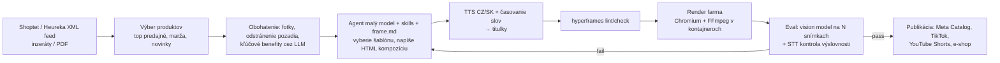

# Deep dive: „Video ako kód“ pre CZ/SK e-commerce a marketing

*Stav k 15. 10. 2026. Čo sa nepodarilo overiť, je označené „(neoverené)“. Odhady, ktoré sú moje vlastné výpočty, sú označené ako „odhad“.*

## 1. Čo to je a prečo práve teraz

**Myšlienka:** Video sa netočí ani negeneruje difúznym modelom. AI agent ho **napíše ako webovú stránku** (HTML/CSS/JS s časovou osou). Renderer ju otvorí v headless Chromiu, posúva čas snímok po snímku, každý snímok odfotí a FFmpeg z nich poskladá MP4. Výstup je deterministický: rovnaký vstup dá rovnaké pixely. Dá sa teda testovať, verzovať a vyrábať po tisícoch z dát (produktový feed, inzeráty, dokumenty).

**Prečo teraz:**
- HeyGen v roku 2026 zverejnil framework **HyperFrames** (Apache-2.0). Je navrhnutý tak, aby video zvládol napísať aj malý, lacný model. Vďaka tomu sú náklady na jedno video v centoch.
- Meta od mája 2024 podporuje **video v katalógových reklamách** (Catalog Product Ads, Advantage+). E-shop teda môže mať ku každému produktu video a reklamný systém si ho sám vyberie ([Social Media Today](https://www.socialmediatoday.com/news/meta-adds-video-to-its-automated-catalog-ads/716802/)).
- Kvalitné TTS v češtine a slovenčine je dnes bežne dostupné (ElevenLabs, Google Chirp 3 HD, Azure), viď sekciu 3.

**Čo zaznelo na konferencii:**
- **„HTML Is All Agents Need“** (James Russo, HeyGen, track Generative Media, deň 4, 11:10):
  - Rok pokusov: najprv obrovské prompty a priemerný výstup, potom agentické iterácie.
  - Potom Remotion: dal determinizmus, ale React agenta „zatváral do škatule“. Čím viac guardrails, tým nudnejšie videá.
  - Čisté HTML/CSS/JS vrátilo výstupom kreativitu. Framework ladili tak, aby fungoval s **Gemini Flash**: „ak framework potrebuje najväčší model, bojuje proti agentovi“.
  - Hlavný inžiniersky problém je determinizmus prehliadača (asynchrónne dekódery obrázkov, načítavanie fontov, animačné hodiny).
  - Agentické slučky so self-improving evals a **skills, ktoré dávajú „taste“ namiesto guardrails**.
- **„Building an Agentic Video Editor for Mass Consumer“** (Ekaterina Deyneka, Reelful):
  - Mobilný agent skladá krátke videá z fotiek a videí v galérii.
  - Reťazí modely naprieč modalitami (vision → language → speech → video) a odovzdáva kontext a stav medzi krokmi viacminútového jobu.
  - „UX inverzia“: agent odvodí zámer zo samotných médií a používateľ nemusí nič promptovať. To je presne model pre e-shopára, ktorý nechce nič nastavovať.
- **„Evaling Video Slop“** (Maor Bril, Character.ai, track Evals):
  - CLIP score nezachytí časovú nekoherenciu a ručná kontrola „v piatok pozrieme pár klipov“ neškáluje.
  - AI judge s vlastnými rubrikami treba kalibrovať voči ľudským hodnoteniam (Pearson/Spearman).
  - Pairwise preferenčný model na Qwen3-VL (Bradley-Terry): „je toto slop?“.
  - Regresné brány v CI. Open source [JudgeJudy](https://github.com/character-ai/judgejudy).
- **„The Missing Layer: Design Taste in AI Agents“** (Hassan El Mghari, Together AI, track Design Engineering):
  - Agent dá pekný výstup, keď má kontext o produkte a **reálnu inšpiráciu vo forme screenshotov**.
  - Ohlásil OSS projekt (prompt builder, MCP server s inšpiráciou, design-eng skill). Priamo použiteľné pre „brand taste“ videí.
- **„Generative UI... in Python?“** (Jeremiah Lowin, FastMCP/Prefab):
  - Väčšina UI sa nemusí navrhovať od nuly, stačí ju poskladať z hotových komponentov cez token-efektívne DSL.
  - Pre nás: agent nemá písať každé video od nuly, má skladať overené bloky.
- Ostatné talky v tracku Generative Media (Krea 2, real-time video, world modely: Reactor, „Generative Video at the Speed of Light“) sa týkajú generatívnych modelov, nie programatického videa. Pre náš use-case sú skôr kontext.

## 2. Technológia

### HyperFrames do hĺbky (overené na GitHube a npm k 15. 10. 2026)

- **Repo a licencia:** [github.com/heygen-com/hyperframes](https://github.com/heygen-com/hyperframes), Apache-2.0, ~64,3k hviezdičiek, repo založené 10. 3. 2026, aktívny vývoj (posledný push 15. 10. 2026).
- **Verzia:** npm balík [`hyperframes`](https://www.npmjs.com/package/hyperframes), `latest` = **0.8.162**. Stále 0.x, teda API sa môže meniť.
- **Požiadavky:** Node.js ≥ 22, FFmpeg, prostredie schopné spustiť Chromium/Puppeteer. Render beží lokálne, v Dockeri, cez HeyGen cloud (`cloud render`) alebo na AWS Lambda (`@hyperframes/aws-lambda`).
- **Licenčné náklady:** README uvádza „no per-render fees or commercial-use thresholds“.
- **Ako sa píše kompozícia:**
  - Koreňový element má `data-composition-id`, `data-start`, `data-width` a `data-height`.
  - Klipy (`<video>`, ``, `<h1>`, `<audio>`) majú `class="clip"` a atribúty `data-start`, `data-duration`, `data-track-index` (audio aj `data-volume`).
  - Animácie bežia na pozastavenej GSAP timeline zaregistrovanej do `window.__timelines`. Cez „frame adaptéry“ funguje aj CSS, Lottie, Three.js, Anime.js a WAAPI.
  - Nie je potrebný build krok, `index.html` sa dá rovno otvoriť v prehliadači. Podporuje sub-kompozície a premenné (ideálne pre šablónu „produkt X“).
- **CLI:** `npx hyperframes init`, `preview` (live reload), `lint`, `check`, `snapshot`, `render`, `publish`, `doctor`, `add` (bloky z katalógu), `catalog`, `skills update`, `lambda deploy/render/progress`.
- **Skills (21):**
  - Router `/hyperframes`.
  - Workflow skills: `/product-launch-video`, `/faceless-explainer`, `/slideshow`, `/motion-graphics`, `/pr-to-video`, `/music-to-video`, `/embedded-captions`, `/remotion-to-hyperframes`.
  - Doménové skills: `/hyperframes-core`, `/hyperframes-animation`, `/hyperframes-cli`, `/hyperframes-audio` (ducking hudby pod hlas, EQ, kompresor), `/media-use` (získa alebo vygeneruje médiá: TTS, hudbu, obrázky, prepis, titulky, odstránenie pozadia).
  - Inštalácia: `npx skills add heygen-com/hyperframes`.
- **frame.md:** prekladá brand `design.md` na pravidlá pre video (tokeny, typografia, mierka). Je to priamy nástroj na brandovú konzistenciu. K tomu katalóg dizajnových šablón na [hyperframes.dev/design](https://www.hyperframes.dev/design).
- **Výkon renderu:** oficiálne benchmarky som nenašiel **(neoverené)**. Render je CPU-bound (screenshot každého snímku), 30 s pri 30 fps je 900 snímok. Rýchlosť si treba zmerať v prvom experimente (sekcia 10).
- **Limity:**
  - Studio je „available, evolving“.
  - Lambda render je podľa samotného README menej zrelý ako Remotion Lambda.
  - Generatívny záber (AI footage) neobsahuje, ide o motion design a kompozitovanie médií.
  - **GSAP licencia** je od akvizície Webflow zadarmo aj komerčne, no zakazuje použitie v „no-code nástrojoch na vizuálne animácie“, ktoré konkurujú Webflow ([GSAP license](https://gsap.com/community/standard-license/)). Pre SaaS, kde zákazník animácie neklikne sám, je to pravdepodobne v poriadku. Ak by sme však stavali vizuálny editor, treba to dať pozrieť právnikovi alebo použiť Anime.js/WAAPI (MIT).

### Porovnanie s alternatívami

| Nástroj | Model | Licencia / cena | Kedy |
|---|---|---|---|
| **HyperFrames** | HTML + seekovateľné animácie, Chromium + FFmpeg | Apache-2.0, zadarmo | Agent píše video, vlastná render farma, žiadne licenčné riziko |
| **Remotion** | React komponenty | Source-available. Zadarmo len pre firmy do 3 zamestnancov. Potom **Automators $0,01/render, minimum $100/mes.**, Creators $25/seat/mes., Enterprise od $500/mes. ([Remotion pricing](https://www.remotion.dev/docs/pricing)) | Najzrelší ekosystém a Lambda. Pre SaaS, ktorý renderuje v mene zákazníkov, **platíte vždy, keď narastiete nad 3 ľudí** |
| **Motion Canvas** | TypeScript generátory, editor | MIT (neoverené) | Samostatný nástroj na animácie, nie knižnica pre pipeline |
| **Revideo** | Fork Motion Canvas ako knižnica | Open source (licencia neoverená). Podľa jedného zdroja sa projekt presunul pod komerčný Midrender ([Wireflow](https://www.wireflow.ai/blog/best-remotion-alternatives-in-2026)) | Roadmapa závisí od komerčného produktu, je to riziko |
| **Shotstack** | JSON timeline cez API | $0,20/min (PAYG) až $0,05/min (Volume $499/mes.) ([pricing](https://shotstack.io/pricing/)) | Rýchly štart bez vlastnej infraštruktúry, menšia kreatívna voľnosť |
| **Creatomate** | Šablóny + JSON/feed | Kredity, ~14 kreditov = 1 min pri 720p. Growth (10k kreditov) ≈ 12 h videa. Ceny plánov sa nenačítali (neoverené) ([pricing](https://creatomate.com/pricing)) | Má priamo „feed rows“, je to priama konkurencia pre feed → video |
| **JSON2Video** | JSON API | $49,95/mes. za 200 min, $99,95 za 500 min ([pricing](https://json2video.com/pricing/)) | Jednoduché slideshow videá |
| **Generatívne video (Veo, Sora, Kling, Runway)** | Difúzne modely | Veo 3.1 Fast ~$0,10–0,12/s, Standard ~$0,40/s s audiom. Kling 3 ~$0,08–0,39/s. Sora 2 API má byť podľa OpenAI zrušené 24. 9. 2026 ([invideo](https://invideo.io/blog/ai-video-model-pricing), [CometAPI](https://www.cometapi.com/ai-video-api-pricing/)). Runway neoverené | Atmosférické zábery, „lifestyle“ B-roll. **Nie** na presný text, cenu a logo |

**Kedy čo:**
- Text, cena, CTA a presný produkt patria do **HTML** (deterministické, za centy).
- Emócia a pohyb kamery okolo produktu sa dajú doplniť **2–5 s generatívnym klipom** (Veo Fast ~$0,5 za klip) vloženým ako `<video class="clip">`.
- Hybrid je najsilnejší, ale generatívnu časť zapínať len pre top produkty.

## 3. TTS, avatary a titulky pre CZ/SK

| Poskytovateľ | CZ | SK | Cena | Poznámka |
|---|---|---|---|---|
| **ElevenLabs** | áno (v3, Flash v2.5) | áno | Flash/Turbo $0,04/1k znakov, v2/v3 $0,08/1k znakov (≈ za minútu podľa ElevenLabs) ([API pricing](https://elevenlabs.io/pricing/api), [jazyky](https://elevenlabs.io/docs/help-center/other/what-languages-do-you-support)) | Najprirodzenejšie (subjektívne, neoverené testom). Voice cloning na brandový hlas |
| **Google Cloud TTS** | 30 hlasov Chirp 3 HD + Standard/WaveNet | 30 hlasov Chirp 3 HD + Standard/WaveNet | Chirp 3 HD ~$30/1M znakov (neoverené, stránka sa nenačítala) ([hlasy](https://docs.cloud.google.com/text-to-speech/docs/list-voices-and-types)) | Veľa hlasov aj pre slovenčinu |
| **Azure Speech** | `cs-CZ-VlastaNeural`, `cs-CZ-AntoninNeural` | `sk-SK-ViktoriaNeural`, `sk-SK-LukasNeural` | ~$15–16/1M znakov (len sekundárne zdroje, neoverené) ([jazyky](https://learn.microsoft.com/en-us/azure/ai-services/speech-service/language-support?tabs=tts)) | Najlacnejšie. SSML a word-boundary eventy uľahčujú titulky. Znie „robotickejšie“ (neoverené) |
| **OpenAI gpt-4o-mini-tts** | podporuje veľa jazykov (kvalita CZ/SK neoverená) | – | ~$0,015/min (odhad podľa tokenov) ([zdroj](https://www.scribd.com/document/859642842/Pricing-OpenAI-API)) | Prízvuk v CZ/SK treba otestovať |
| **Open source** | XTTS-v2 má češtinu, ale licencia CPML je **nekomerčná** ([HF](https://huggingface.co/coqui/XTTS-v2)). Piper má CZ aj SK, je MIT a beží na CPU, nižšia kvalita ([tts.ai](https://tts.ai/voices/piper/)) | Chatterbox Multilingual (MIT) CZ ani SK **nemá** ([HF](https://huggingface.co/ResembleAI/chatterbox)) | 0 € + compute | Na MVP sa nevyplatí, ide o zlomky centu na video |

**Odporúčanie:** ElevenLabs Flash na MVP. 30 s voiceover je ~450 znakov, teda **~$0,02**. Azure alebo Google ako lacný fallback.

**Avatary:** HeyGen API Avatar IV stojí $3–5/min a Avatar III $1–1,20/min ([HeyGen help](https://help.heygen.com/en/articles/10060327-heygen-api-pricing-explained)). Synthesia mala češtinu podľa archívu z 2022, slovenčinu sa nepodarilo overiť. Avatar je **o 1–2 rády drahší** než HTML video. Ponúkať ho len ako prémiový doplnok (onboarding a tréning).

**Titulky:**
- Keďže text generujeme sami, titulky netreba prepisovať. Stačí časovanie slov z TTS (ElevenLabs vracia timestampy, Azure word-boundary eventy).
- Whisper / gpt-4o-transcribe ($0,006/min, mini $0,003/min, [zdroj](https://convertaudiototext.com/blog/openai-whisper-api-pricing-2026)) slúži ako fallback a kontrola: prepis audia porovnať so skriptom a zachytiť zlú výslovnosť.
- Kinetické titulky rieši skill `/embedded-captions` a bloky z katalógu.

## 4. CZ/SK trh

- **E-shopy:**
  - Shoptet poháňa ~45 tis. českých a slovenských e-shopov ([Lupa, 4/2026](https://www.lupa.cz/n/shoptet/)), z toho viac ako 7 600 slovenských. Slovenské e-shopy na Shoptete mali v H1 2026 obrat 325 mil. € (+20 %) a ~3,5 mil. objednávok ([TASR, 7/2026](https://www.teraz.sk/ekonomika/rok-2026-je-pre-slovenske-e-shopy-pozit/980905-clanok.html)).
  - Shoptet kúpil Team.blue v 9/2025 ([CB Insights](https://www.cbinsights.com/investor/shoptet)).
  - Heureka spolupracuje s viac ako 50 tis. e-shopmi v ČR ([Newstream, 2026](https://www.newstream.cz/zpravy-z-firem/e-shopy-maji-pouze-par-dni-na-splneni-pozadavku-ai-actu-mnoho-z-nich-ale-nevi-co-presne-to-znamena)).
  - Upgates ~1 200 e-shopov (starší, nedatovaný údaj, [CC](https://cc.cz/pronajem-e-shopu-jako-nejrychlejsi-vstup-do-e-commerce-ceska-sluzba-upgates-pohani-pres-tisic-online-obchodu/)).
  - Shoptet má katalóg viac ako 210 doplnkov ([Testado, 6/2026](https://www.testado.cz/recenze-shoptet/)). Listovanie ide cez api@shoptet.cz ([developers.shoptet.cz](https://developers.shoptet.cz/zakladni-informace/)). Rev-share podmienky neoverené.
- **Feed:** Heureka XML feed (`SHOPITEM`, `PRODUCTNAME`, `DESCRIPTION`, `IMGURL`, `IMGURL_ALTERNATIVE`, `PRICE_VAT`, `CATEGORYTEXT`, `PARAM`) **nemá pole pre video** ([špecifikácia](https://sluzby.heureka.cz/napoveda/xml-feed/)). Má však všetko potrebné na vstup: názov, popis, fotky, cenu a parametre.
- **Reality:**
  - Sreality: viac ako 3 400 realitných kancelárií a maklérov ([CzechCrunch](https://cc.cz/zajem-o-nemovitosti-explodoval-inzeratu-je-min-ale-lidi-chodi-na-sreality-cim-dal-vic-chteji-byt-mistem-kde-se-vsechno-vyresi/), nedatované).
  - Bezrealitky tvrdí ~20 % predajov a prenájmov v ČR ([Startitup](https://www.startitup.sk/?p=311495)).
  - Profily SK kancelárií na Nehnutelnosti.sk bežne uvádzajú „video prezentácia“ a „3D obhliadka“ ako službu, ceny však nezverejňujú.
  - Počty inzerátov sa overiť nepodarilo (neoverené).
  - Pozor: dTest varuje, že neoznačené AI vizualizácie nehnuteľností môžu byť klamlivé ([CNN Prima News](https://cnn.iprima.cz/konec-klasickeho-homestagingu-makleri-hromadne-nasazuji-ai-hrozi-ale-klamani-zakaznika-513220)).
- **Ako sa video robí dnes:** agentúra alebo freelancer, Canva alebo CapCut ručne, prípadne vôbec. Konkrétne CZ/SK cenníky agentúrnej produkcie som **neoveril**. Zahraničné odhady sú $3–10k za krátke profesionálne video ([CapCut](https://www.capcut.com/cs-cz/resource/corporate-video-costs)). Na validáciu treba zozbierať 5–10 lokálnych cenových ponúk.
- **Dopyt po krátkom videu:**
  - TikTok má podľa DSA dát ~2 mil. mesačných používateľov v ČR a ~1 mil. v SR ([CzechCrunch](https://cc.cz/nejmensi-podil-aktivnich-uzivatelu-tiktoku-v-populaci-v-ramci-evropske-unie-cesko-a-slovensko/)).
  - Meta katalógové video: formáty 1:1 a 9:16, 15–30 s, MP4 ([Marpipe](https://www.marpipe.com/blog/how-the-new-meta-catalog-product-video-format-changes-creative-strategy-in-2026)).
  - Lokálne dáta o výdavkoch na video reklamy v CZ/SK som nenašiel (neoverené).

## 5. Konkurencia

| Hráč | Čo robí | Cena | Čo nerobí pre CZ/SK |
|---|---|---|---|
| **HeyGen** (vrátane Video Agent) | Avatary, prompt-to-video, product URL → video | Creator $29, Business $149/mes. API Video Agent $2/min ([Creatify](https://creatify.ai/blog/heygen-vs-synthesia-(2026)-pricing-avatars-and-which-one-fits-your-team)) | Shoptet/Heureka feed, lokálne šablóny, fakturácia v Kč |
| **Synthesia** | Avatary pre L&D | Starter $29/mes., Creator $89 | E-commerce feed, SK hlas (neoverené) |
| **Creatify / Arcads** | UGC-style reklamy s avatarmi | Creatify $39/mes. a API od $99. Arcads Starter $77–110/mes. za ~10 videí ([Arcads pricing](https://creatify.ai/blog/arcads-pricing-(2026)-plans-credits-and-what-you-ll-actually-pay)) | Masový feed, CZ/SK UGC autentickosť |
| **Pictory / InVideo** | Text/blog → video | InVideo $20–100/mes., Pictory od £22 ([porovnanie](https://marcandrews.com/invideo-vs-pictory-2026-which-ai-video-tool-wins/)) | Feed, automatizácia |
| **Shopify video appky** (Cinemerce, VideoMagic, Videe, Videomate) | Fotky produktu → video | Cinemerce $39/5 videí, VideoMagic $270/1000 videí ([Shopify App Store](https://apps.shopify.com/videomagic?locale=cs)) | **Shoptet neexistuje**, všetko je pre Shopify |
| **Hunch, Smartly** (dynamic creative) | Feed → šablónové videá pre Meta katalóg | Hunch od ~€2 500/mes. ([review](https://admanage.ai/blog/hunch-ads-review)), Smartly enterprise (neoverené) | Malé a stredné CZ e-shopy si to nedovolia |
| **Creatomate, Shotstack** | API a šablóny | viď sekciu 2 | Hotový produkt pre e-shopára, agent a „taste“ |
| **Vidyard** | Video messaging pre sales | – | Iný use-case |

**Lokálne CZ/SK:**
- Aktívny CZ/SK produkt „feed → video“ ani Shoptet doplnok na video **som nenašiel**. Katalóg doplnkov treba prejsť ručne.
- Vivideo.ai má české landing pages pre reality a agentúry, pôvod firmy nie je uvedený ([Vivideo](https://vivideo.ai/cs/reseni/umela-inteligence-video-pro-reality)).
- bot.media (SK) robí avatary pre L&D a interné komunikácie ([RankmyAI](https://www.rankmyai.com/tools/41f2b743-65e3-4da2-9a74-551eeccd2bde/botmedia)).
- Vibepeak (ES) robí realitné videá z fotiek pre RE/MAX a Century 21 ([správa](https://startups.one.gob.es/news/feed/vibepeak-raises-500k-led-by-4founders-capital-to-accelerate-ai-powered-real-estate-video-platform)). Zatiaľ len v Španielsku, ale je to vzor aj potenciálny konkurent.

**Medzera:** natívne napojenie na Shoptet/Heureka feed, CZ/SK hlas a titulky, šablóny pre CZ zvyklosti (cena s DPH, „doprava zdarma“, Heureka hodnotenie), cena v Kč pre malé e-shopy a automatický upload do Meta katalógu.

## 6. Ako to postaviť technicky

**Kroky:**
1. **Ingest:** parsovanie Heureka/Shoptet XML a delta podľa `ITEM_ID`, aby sa renderovali len zmeny ceny alebo nové produkty.
2. **Agent:** neprepisuje celé video. Vyberie jednu z 5–10 overených šablón (sub-kompozície) a vyplní premenné. Voľnú tvorbu povoliť len pre „hero“ videá. Taste zabezpečia skills plus `frame.md` z brandu e-shopu (farby a fonty vytiahnuté z webu) plus screenshoty inšpirácie (prístup z talku Together AI).
3. **Render:**
   - Kontajner s Chromiom, FFmpeg a fontmi.
   - Na štart Hetzner dedicated alebo CCX (lacný CPU) s frontou (BullMQ/Redis). Špičky riešiť cez Modal alebo AWS Lambda, ktorú HyperFrames podporuje natívne.
4. **Eval:**
   - Lacný vision model dostane 6–8 snímok a rubriku: text pretečený mimo plochy, chýbajúca diakritika (tofu boxy), nečitateľný kontrast, zlá cena oproti feedu.
   - Plus porovnanie STT prepisu so skriptom.
   - Pravidelne kalibrovať voči ľudskému hodnoteniu (JudgeJudy prístup).
5. **Publikácia:** video URL do Meta katalógu (Commerce Manager / Catalog API, presné pole treba overiť), TikTok a YouTube cez API, do e-shopu cez Shoptet API ako galériu produktu (neoverené).

**Odhad nákladov na jedno 30 s video (moje výpočty, nie overené merania):**

| Položka | Odhad |
|---|---|
| LLM (malý model, ~20–30k tokenov vrátane skills) | ~$0,01–0,08 (neoverené, závisí od modelu a cachovania promptu) |
| TTS ElevenLabs Flash (~450 znakov) | ~$0,02 (Azure ~$0,007) |
| STT kontrola | ~$0,003 |
| Render (900 snímok, CPU) | < $0,01 pri vlastných serveroch (neoverené, zmerať) |
| Vision eval (6–8 snímok) | ~$0,005–0,02 (neoverené) |
| **Spolu** | **~$0,05–0,15 za video** |

Pre porovnanie: samotný render na Shotstacku stojí $0,025–0,10 za 30 s a HeyGen avatar $0,5–2,5 za 30 s.

**Čo je ťažké:**
- **Determinizmus:** fonty sa načítajú neskoro, obrázky sa dekódujú asynchrónne, `Date.now()` a CSS animácie bežia mimo seekovateľnej timeline. HyperFrames to rieši, ale vlastné bloky musia dodržať pravidlá z `/hyperframes-core` (používať `lint` a `check`).
- **Diakritika:** fonty s plnou latin-ext podporou (ě, ř, ů, ľ, ĺ, ŕ, ô) inštalovať lokálne do kontajnera, nie cez CDN. Eval musí kontrolovať tofu boxy a orezanú diakritiku pri veľkých titulkoch.
- **Výslovnosť TTS:** značky, čísla, ceny („1 299 Kč“), jednotky a anglicizmy. Treba normalizáciu textu a slovník výslovnosti.
- **Slop a nuda:** 10 000 videí z jednej šablóny vyzerá rovnako. Treba rotovať varianty a A/B testovať na CTR.
- **Brand konzistencia:** e-shop nemá design system, treba ho automaticky extrahovať (frame.md).
- **Kvalita vstupov:** fotky z feedu majú nízke rozlíšenie a biele pozadie, často bez lifestyle záberov.

## 7. MVP za 4–6 týždňov

**Scope:** „Shoptet produktové reels z feedu“.
- Vstup: URL Heureka/Shoptet feedu a logo.
- Výstup: 9:16 a 1:1 videá (15–20 s) pre top 20–50 produktov, CZ alebo SK voiceover, titulky, cena a CTA.
- 3 šablóny: „produkt + benefity“, „akcia/zľava“, „novinka“.
- Export: ZIP a CSV s URL na nahratie do Meta katalógu. Natívna integrácia až po MVP.

| Týždeň | Obsah |
|---|---|
| 1 | HyperFrames spike, 3 šablóny ručne, fonty s diakritikou, meranie rýchlosti renderu |
| 2 | Parser feedu, agent (výber šablóny + texty), TTS + titulky |
| 3 | Render worker v Dockeri na Hetzneri, fronta, vision eval |
| 4 | Jednoduchý web (feed URL → galéria videí → schválenie → stiahnutie), platby |
| 5–6 | Piloti s 5–10 e-shopmi, iterácia šablón podľa CTR v Meta Ads; podanie žiadosti o Shoptet doplnok |

**Prvých 10 zákazníkov:**
1. **Ukážka bez pýtania:** stiahnuť verejný Heureka feed 50 e-shopov z jednej kategórie (kozmetika, outdoor, hračky), vygenerovať 3 videá a poslať ich e-mailom („toto sú vaše produkty, zadarmo“).
2. **PPC a performance agentúry** (spravujú desiatky e-shopov). Jedna agentúra môže priniesť 5–10 klientov.
3. Shoptet partneri a komunita: Shoptet Premium, facebookové skupiny e-shopárov, akcie ako Shoptet Fest (neoverené) a e-commerce meetupy.
4. **Realitky:** pilot s 2–3 kanceláriami (napríklad 20 inzerátov → 20 reels zadarmo) ako druhý segment.

## 8. Biznis model a cenotvorba

Ceny sú návrh, treba ich validovať.

| Model | Návrh | Pre koho |
|---|---|---|
| **Mesačné balíky** | 490 Kč/mes. (20 videí), 1 490 Kč (100 videí), 4 990 Kč (500 videí + auto-refresh pri zmene ceny) | Malé a stredné e-shopy cez Shoptet doplnok |
| **Per SKU** | ~5–10 Kč/SKU/mes. za „živé“ video, ktoré sa pri zmene ceny alebo akcie prerenderuje | Väčšie katalógy pre Meta catalog ads |
| **Per video** | 20–50 Kč za kus, prémiové hero video s generatívnym B-rollom 300–1 000 Kč | Ad-hoc |
| **White-label pre agentúry** | Platforma za €200–1 000/mes. + volume | Marketingové a PPC agentúry |
| **Reality** | Za inzerát (napr. 99–199 Kč) alebo paušál pre kanceláriu | RK, developeri |

Pri náklade ~$0,1 na video je hrubá marža aj pri 20 Kč za video vysoká. Limitom je predaj, nie COGS.

**Kanály:** Shoptet doplnky (najväčší dosah v CZ/SK), Upgates a ďalšie platformy, white-label pre agentúry, realitné CRM a portály ako partneri (Sreality a Nehnutelnosti.sk by mohli ponúkať „video k inzerátu“ ako upsell).

## 9. Riziká a otvorené otázky

- **HeyGen to spraví sám:** HyperFrames je ich engine a majú Video Agent aj product-URL-to-video. Obrana je lokálna distribúcia (Shoptet, agentúry), CZ/SK kvalita, feed a katalógová automatizácia a podpora v Kč. Globálni hráči nebudú robiť Shoptet doplnok.
- **Komoditizácia:** Creatomate, Shotstack a Shopify appky už robia feed → video. Moat nie je render, ale distribúcia a dáta o tom, ktoré šablóny predávajú (CTR loop).
- **Platformy a regulácia:**
  - Meta a TikTok označujú AI obsah. Pri syntetických hlasoch a avataroch treba počítať s labelmi.
  - **AI Act čl. 50** (povinnosť transparentnosti pre syntetický obsah) – viď `08-deep-dive-ai-governance-ai-act.md`.
  - Pri realitách hrozí riziko klamlivej reklamy (dTest).
- **Kvalita a slop:** zlé video môže CTR znížiť. Treba merať a ponúknuť zákazníkovi schválenie pred publikovaním.
- **Licencie:** GSAP (no-code klauzula), Remotion (ak by sme ho použili), práva k fotkám z feedu (patria e-shopu alebo dodávateľovi?), hudba (len licencované knižnice).
- **Technické:** HyperFrames je 0.x a mení sa rýchlo. Treba zafixovať verziu a mať vlastné golden testy.
- **Otvorené otázky:**
  - Reálna rýchlosť renderu na CPU.
  - Ochota e-shopov platiť (koľko dnes platia za video).
  - Rev-share a podmienky Shoptet doplnkov.
  - Presné API pole pre video v Meta katalógu.

## 10. Odporúčanie a 5 ďalších krokov

**Odporúčanie:** Ísť do toho ako **úzko zameraný, lacný produkt pre Shoptet e-shopy** (feed → reels s CZ/SK hlasom → Meta katalóg). HyperFrames je správna voľba namiesto Remotion: Apache-2.0, žiadne poplatky za render a navrhnutý pre malé modely. Reality brať ako druhý segment a avatary len ako prémiový doplnok. Moatom má byť distribúcia a performance dáta, nie technológia.

**Ďalšie kroky:**
1. **Technický experiment (2–3 dni):**
   - `brew install ffmpeg && npx hyperframes init test`, nainštalovať skills.
   - Nechať agenta s malým modelom (Gemini Flash alebo Claude Haiku) vyrobiť z 10 produktov reálneho Heureka feedu 9:16 video s ElevenLabs CZ hlasom a titulkami.
   - Merať: čas renderu na 30 s video (M-séria a Hetzner CCX), správnosť diakritiky, výslovnosť cien, náklad v tokenoch a % videí, ktoré prejdú bez ručnej opravy.
2. **TTS blind test:** 20 viet (ceny, značky, SK aj CZ) cez ElevenLabs, Google Chirp 3 HD a Azure. Nechať ohodnotiť 5 ľudí.
3. **Cenová validácia:** 10 rozhovorov s e-shopármi a 3 s PPC agentúrami (čo dnes platia za video a koľko videí potrebujú) a zozbierať reálne cenníky agentúr.
4. **Shoptet:** kontaktovať api@shoptet.cz (podmienky doplnku, rev-share, API na nahratie videa k produktu) a prejsť katalóg doplnkov kvôli konkurencii.
5. **Pilot s Meta Ads:** u 2–3 e-shopov pridať videá do katalógu a A/B porovnať CTR a CPA voči statickým obrázkom počas 2 týždňov. Toto číslo je hlavný predajný argument.

## 11. Zdroje

**Konferencia a kontext**
- `conference/sessions.json` (talky: HTML Is All Agents Need, Building an Agentic Video Editor for Mass Consumer, Evaling Video Slop, The Missing Layer: Design Taste in AI Agents, Generative UI... in Python?)
- `03-deep-dive-context-agenti-video.md`, sekcia 1
- [JudgeJudy (Character.ai)](https://github.com/character-ai/judgejudy)

**Technológia**
- [HyperFrames – GitHub](https://github.com/heygen-com/hyperframes)
- [HyperFrames – README (raw)](https://raw.githubusercontent.com/heygen-com/hyperframes/main/README.md)
- [hyperframes – npm](https://www.npmjs.com/package/hyperframes)
- [HyperFrames docs](https://hyperframes.heygen.com/)
- [HyperFrames vs Remotion guide](https://hyperframes.heygen.com/guides/hyperframes-vs-remotion)
- [HyperFrames AWS Lambda](https://hyperframes.heygen.com/deploy/aws-lambda)
- [HyperFrames design templates](https://www.hyperframes.dev/design)
- [themenonlab – HeyGen open-sources HyperFrames](https://themenonlab.blog/blog/heygen-hyperframes-video-as-code)
- [silenceper – HyperFrames](https://silenceper.com/en/article/2026-05-02-hyperframes-html-video-rendering/)
- [noqta – HyperFrames](https://www.noqta.tn/en/blog/heygen-hyperframes-html-to-mp4-ai-agent-video-2026)
- [Remotion pricing](https://www.remotion.dev/docs/pricing)
- [Remotion terms](https://www.remotion.dev/docs/terms)
- [Revideo docs](https://docs.re.video/)
- [Wireflow – Remotion alternatives 2026](https://www.wireflow.ai/blog/best-remotion-alternatives-in-2026)
- [GSAP Standard License](https://gsap.com/community/standard-license/)
- [Shotstack pricing](https://shotstack.io/pricing/)
- [Creatomate pricing](https://creatomate.com/pricing)
- [JSON2Video pricing](https://json2video.com/pricing/)
- [invideo – AI video model pricing](https://invideo.io/blog/ai-video-model-pricing)
- [CometAPI – AI video API pricing](https://www.cometapi.com/ai-video-api-pricing/)

**TTS a avatary**
- [ElevenLabs API pricing](https://elevenlabs.io/pricing/api)
- [ElevenLabs jazyky](https://elevenlabs.io/docs/help-center/other/what-languages-do-you-support)
- [Google Cloud TTS hlasy](https://docs.cloud.google.com/text-to-speech/docs/list-voices-and-types)
- [Google Cloud TTS pricing](https://cloud.google.com/text-to-speech/pricing)
- [Azure Speech jazyková podpora](https://learn.microsoft.com/en-us/azure/ai-services/speech-service/language-support?tabs=tts)
- [Azure Speech pricing](https://azure.microsoft.com/en-us/pricing/details/cognitive-services/speech-services/)
- [CostBench – Microsoft Speech](https://costbench.com/software/ai-voice-tools/microsoft-speech/)
- [OpenAI pricing (kópia, Scribd)](https://www.scribd.com/document/859642842/Pricing-OpenAI-API)
- [Whisper API pricing 2026](https://convertaudiototext.com/blog/openai-whisper-api-pricing-2026)
- [XTTS-v2](https://huggingface.co/coqui/XTTS-v2)
- [Chatterbox](https://huggingface.co/ResembleAI/chatterbox)
- [Piper (tts.ai)](https://tts.ai/voices/piper/)
- [HeyGen API pricing](https://help.heygen.com/en/articles/10060327-heygen-api-pricing-explained)
- [Synthesia jazyky](https://help.synthesia.io/en/articles/6341860-languages-voices-accents)

**Trh CZ/SK**
- [Lupa – Shoptet](https://www.lupa.cz/n/shoptet/)
- [TASR – slovenské e-shopy 2026](https://www.teraz.sk/ekonomika/rok-2026-je-pre-slovenske-e-shopy-pozit/980905-clanok.html)
- [CB Insights – Shoptet](https://www.cbinsights.com/investor/shoptet)
- [Newstream – e-shopy a AI Act (Heureka 50k)](https://www.newstream.cz/zpravy-z-firem/e-shopy-maji-pouze-par-dni-na-splneni-pozadavku-ai-actu-mnoho-z-nich-ale-nevi-co-presne-to-znamena)
- [CC – Upgates](https://cc.cz/pronajem-e-shopu-jako-nejrychlejsi-vstup-do-e-commerce-ceska-sluzba-upgates-pohani-pres-tisic-online-obchodu/)
- [Testado – recenze Shoptet](https://www.testado.cz/recenze-shoptet/)
- [Shoptet developers](https://developers.shoptet.cz/zakladni-informace/)
- [Heureka XML feed špecifikácia](https://sluzby.heureka.cz/napoveda/xml-feed/)
- [CzechCrunch – Sreality](https://cc.cz/zajem-o-nemovitosti-explodoval-inzeratu-je-min-ale-lidi-chodi-na-sreality-cim-dal-vic-chteji-byt-mistem-kde-se-vsechno-vyresi/)
- [Startitup – Bezrealitky na Slovensku](https://www.startitup.sk/?p=311495)
- [Novinky – AI v realitách](https://www.novinky.cz/clanek/internet-a-pc-ai-umela-inteligence-muze-usnadnit-prodej-nemovitosti-nahrava-ale-i-podvodnikum-40589493)
- [CNN Prima News – AI homestaging](https://cnn.iprima.cz/konec-klasickeho-homestagingu-makleri-hromadne-nasazuji-ai-hrozi-ale-klamani-zakaznika-513220)
- [CzechCrunch – TikTok CZ/SK](https://cc.cz/nejmensi-podil-aktivnich-uzivatelu-tiktoku-v-populaci-v-ramci-evropske-unie-cesko-a-slovensko/)
- [MediaGuru – TikTok v Česku](https://www.mediaguru.cz/tiktok-se-v-cesku-blizi-k-2-5-milionum-chysta-dalsi-cileni)
- [CapCut – náklady na firemné video](https://www.capcut.com/cs-cz/resource/corporate-video-costs)
- [Social Media Today – Meta video v catalog ads](https://www.socialmediatoday.com/news/meta-adds-video-to-its-automated-catalog-ads/716802/)
- [Marpipe – Meta catalog product video 2026](https://www.marpipe.com/blog/how-the-new-meta-catalog-product-video-format-changes-creative-strategy-in-2026)

**Konkurencia**
- [Creatify – HeyGen vs Synthesia 2026](https://creatify.ai/blog/heygen-vs-synthesia-(2026)-pricing-avatars-and-which-one-fits-your-team)
- [Creatify – HeyGen pricing 2026](https://creatify.ai/blog/heygen-pricing-(2026)-plans-and-what-you-ll-actually-pay)
- [Creatify – Arcads pricing 2026](https://creatify.ai/blog/arcads-pricing-(2026)-plans-credits-and-what-you-ll-actually-pay)
- [Toolquestor – Creatify vs InVideo](https://toolquestor.com/vs/creatify-vs-invideo)
- [Marc Andrews – InVideo vs Pictory 2026](https://marcandrews.com/invideo-vs-pictory-2026-which-ai-video-tool-wins/)
- [Shopify – Cinemerce](https://apps.shopify.com/cinemerce?locale=cs)
- [Shopify – VideoMagic](https://apps.shopify.com/videomagic?locale=cs)
- [Shopify – Videe](https://apps.shopify.com/videe?locale=cs)
- [Hunch DPA](https://hunchads.com/dpa)
- [Hunch review (AdManage)](https://admanage.ai/blog/hunch-ads-review)
- [Vivideo – reality](https://vivideo.ai/cs/reseni/umela-inteligence-video-pro-reality)
- [bot.media (RankmyAI)](https://www.rankmyai.com/tools/41f2b743-65e3-4da2-9a74-551eeccd2bde/botmedia)
- [Vibepeak – investícia](https://startups.one.gob.es/news/feed/vibepeak-raises-500k-led-by-4founders-capital-to-accelerate-ai-powered-real-estate-video-platform)
