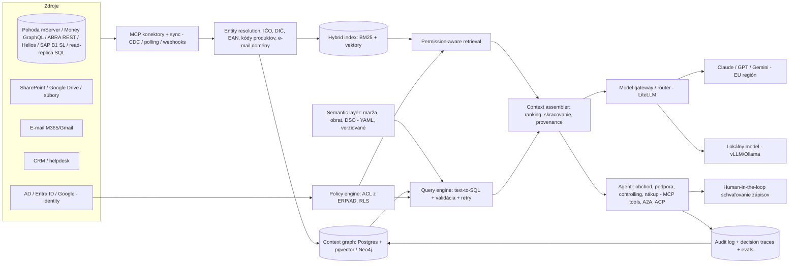

# Deep dive: Context engine nad dátami CZ/SK firiem (ERP + dokumenty) s agentmi nezávislými od modelu

*Stav k 15. 10. 2026. Čo som neoveril webom, je označené „(neoverené)“.*

---

## 1. Čo to je a prečo teraz

**Pointa jednou vetou:** robíme vrstvu, ktorá agentom dá *správny, povolený a čerstvý* kontext z ERP, dokumentov, e-mailu a CRM firmy. Nad ňou bežia agenti pre obchod, podporu, controlling a nákup a model pod nimi sa dá vymeniť.

**RAG vs. context engine vs. context graph – rozdiel zrozumiteľne:**

| | Čo robí | Príklad otázky, ktorú zvládne | Kde zlyhá |
|---|---|---|---|
| **RAG** | Text sa rozseká, vloží do vektorovej DB a k otázke sa nájdu podobné kúsky | „Aké máme dodacie podmienky?“ | „Koľko nám dlhuje Alza a rastie jej obrat?“ – v PDF to nie je, odpoveď je v tabuľkách ERP |
| **Context engine** | Rozhodne, z ktorých zdrojov čerpať (SQL nad ERP, vyhľadávanie v dokumentoch, živé API). Overí oprávnenia, zostaví a skráti kontext, validuje dotazy | „Stav zákazníka X: otvorené faktúry, posledné objednávky, reklamácie, e-maily“ | Bez modelu entít a histórie nevie, *prečo* sa niečo stalo |
| **Context graph** | Trvalý graf entít (firma, IČO, produkt, osoba, zmluva), vzťahov a **decision traces**, teda kto čo schválil a aké výnimky platia | „Prečo má X zľavu 12 %? Kto to schválil a platí to aj pre nový produkt?“ | Je drahý na údržbu a entity resolution je ťažká |

**Prečo teraz:** (a) Existuje MCP ako štandard konektorov a komunita už robí MCP servery pre Pohodu, Money S3 aj ABRA Flexi (pozri sekciu 2). (b) Open-weight modely sa dajú prevádzkovať on-prem (konferencia ukazovala GLM 5.2 na DGX Station). (c) Stredné firmy v CZ/SK AI zatiaľ využívajú málo a ako hlavné bariéry uvádzajú nedostatok expertízy, nejasné právne dôsledky a ochranu dát. Presne tieto bariéry rieši služba „on-prem + implementácia“ (sekcia 6).

**Čo zaznelo na konferencii:**
- **Unblocked – Peter Werry („Beyond RAG“ workshop + „mergeable code“ talk):** NL → *validované* DB dotazy, schema-aware prompting, identity resolution, retry pri chybe; viac MCP dáva agentom *prístup*, nie *porozumenie*. Vzor pre text-to-SQL nad ERP.
- **Atlan – „WTF Is the Context Layer?“:** chýbajú biznis definície a normy; verziované, testovateľné „context repos“, simulácie, traces späť do kontextu, otvorenosť (MCP, Iceberg).
- **Merge – „Why your company needs a context graph“:** context graph ako control plane (zdroje, živé vs. cache dáta, oprávnenia), latencia < 300 ms, povinná provenance, **viac kontextu = horšie odpovede**.
- **monday.com – „From Systems of Record to Systems of Context“:** decision traces (výnimky, kto čo schválil) sú skutočný moat.
- **typedef – „The Data Context Layer“:** lineage, sémantika metrík, runtime signály. **Neo4j (GraphRAG workshop, „Context Graphs“):** vzťahy entít v retrievale.
- **PromptQL – „Your company brain will leak secrets“:** jedna chybná odpoveď nesprávnemu človeku = únik; oprávnenia na dáta *aj* nástroje *aj* semantic layer, „auto-learning bez auto-leaking“.
- **Band.ai (Vlad Luzin), Warp Oz, Block „Universal Remote Control for AI“ (ACP, `/acp` endpoint zladený s MCP):** agenti rôznych vendorov ako rovnocenní peeri, model-agnostic orchestrácia cez otvorené protokoly.
- **DSPy „Separating the Task from the Model“, Inngest „half-life of 6 months“, Kimchi (routing frontier/open-weight, ~2,5× lacnejšie):** úloha ako signatúra, trvalé primitíva namiesto trendov, hybridný routing.
- **Tailscale „Without the Lock-In“ (Aperture, identity-aware MCP konektory), Airbyte „Agent MCP Server“ (stovky zdrojov za jedným endpointom):** konektivita ako komodita.
- **„Guardians of the State: Air-Gapped AI Fortress“ + Local AI track (GLM 5.2 na DGX Station, panel „Model Routing“):** air-gapped open-weight modely, dvojprechodová PII sanitizácia; hybrid lokálny + cloud je nový default.

---

## 2. CZ/SK ERP krajina a prístup k dátam

**Veľkosť a pozícia vendorov.** Presné aktuálne podiely na trhu verejne nie sú, štúdie CVIS/IDC sú staršie alebo platené.

| ERP (vendor) | Čo vieme | Prístup k dátam | Vlastná AI? |
|---|---|---|---|
| **Pohoda (Stormware)** | Podľa vendora predaných >170 tis. licencií v CZ+SK. Silná u malých firiem, živnostníkov a účtovníkov | **mServer**: HTTP server v Pohode (predvolený port 444, XML „dataPack“). Varianty SQL/E1 bežia na MS SQL (neoverené) | V release Október 2026 (14400) žiadna AI. Jediná zmienka je informačný obsah o AI Acte |
| **Money S3/S4/S5 (Seyfor)** | Seyfor: tržby >4 mld. Kč, klienti v 38 krajinách (2024). Presný počet firiem na Money nie je verejný | **Money S3: GraphQL API** (platený modul, kľúč API viazaný na používateľa a jeho práva, čítanie real-time, zápis asynchrónne cez frontu). Money S5: verejnú API dokumentáciu som nenašiel (neoverené) | Seyfor predáva AI agentov (HR, reporting) pre M365/Google, nie ako súčasť Money. V roku 2024 kúpil 35 % v Digitask |
| **Helios (Asseco Solutions)** | Asseco Solutions >15 000 zákazníkov (údaj vendora). Historicky líder v stredných firmách (2011: >22 % segmentu 50–249) | iNuvio/Easy: REST API cez eServer (Keboola konektor). Nephrite: REST API na roadmape 2023–25. Orange/Green na MS SQL (neoverené) | iNuvio má ML funkcie (detekcia nezvyčajných zmien cien pri príjme tovaru, odhad absencií), cloud AVAplace. Agent/copilot nad ERP som nenašiel |
| **ABRA Flexi / ABRA Gen** | Tržby ABRA >300 mil. Kč (rok neuvedený). Od 2/2026 súčasť SelectLine Group | **REST API (JSON/XML)**, kupuje sa zvlášť, práva podľa používateľa. Verejné demo | Natívny AI asistent nie je. AI cez partnerov (Digitoo, Billy, ALICE) |
| **K2** | ~500 firiem, priemerne 50 používateľov (údaj z 2015) | REST API na IIS, XML/JSON | Nenašiel som |
| **SAP Business One** | – | **Service Layer**, OData v4 na `/b1s/v2/`, session login, rovnaká biznis logika ako klient | Joule cieli na S/4HANA a BTP. Pre B1 som priamu podporu nenašiel |
| **Altus Vario** | – | Nenašiel som verejnú API dokumentáciu (neoverené) | (neoverené) |
| **Odoo** | – | XML-RPC/JSON-RPC external API (neoverené webom, všeobecne známe) | Odoo má AI funkcie (neoverené) |

**Kľúčové zistenie: konektory sa komoditizujú.** Na GitHube už existujú open-source MCP servery:
- **dg/pohoda-mcp** (PHP, cez mServer, v0.0.4 z 24. 7. 2026). Maintainer `dg` sa zhoduje s handle Davida Grudla, autorstvo explicitne nepotvrdené.
- **INTEVIA/money-s3-mcp-server**: 129 nástrojov cez GraphQL, čítanie aj zápis, Docker.
- **VitexSoftware/abraflexi-mcp-server** a **lwsinclair/abra-flexi-mcp**.

**Dôsledok:** moat nie je samotný konektor. Moat je *sémantika, oprávnenia, entity resolution, decision traces a implementácia*.

**ERP vendori a AI:** k októbru 2026 žiadny z veľkých lokálnych vendorov (Stormware, Seyfor/Money, ABRA, K2) nemá verejne zdokumentovaného agenta s „chat nad celým ERP + dokumentmi“. Asseco smeruje k AI najviac, ale skôr ML funkciami vnútri produktu. Okno je otvorené, no nie navždy (sekcia 9).

---

## 3. Konkurencia

**Globálni hráči:**

| Hráč | Pozícia | Cena (ak známa) | Slabina pre CZ/SK strednú firmu |
|---|---|---|---|
| **Microsoft 365 Copilot + Graph, Fabric IQ / Work IQ / Foundry IQ** | Najväčšia hrozba. Ontologická „IQ“ vrstva nad M365 a Fabric | Copilot Business (<300 používateľov) $21/používateľ/mes. (promo $18), Enterprise $30 | Pohodu ani Money natívne nevidí. Vyžaduje M365 a Fabric, žiadne on-prem LLM |
| **Glean** | Enterprise search + agenti | Odhady tretích strán: ~$50+/používateľ/mes., min. ~100 seatov, ACV ~$50–60k | Pre firmu so 100 ľuďmi drahý, bez lokálnych ERP konektorov |
| **Atlan** | Context layer pre dátové tímy | Neverejná | Cieli na data platformy (Snowflake a pod.), nie na Pohodu |
| **Unblocked** | Context engine pre vývojárov | ~$19–29/používateľ (tretie strany) | Iný segment (kód) |
| **Merge** | Unified API + context graph pre SaaS | Neverejná | Ide o SaaS API, lokálne ERP nemá |
| **PromptQL (Hasura)** | Dáta + semantic layer, platí sa za compute | Pay-as-you-go/Enterprise, vlastný LLM bez poplatku za tokeny | Enterprise/US fokus |
| **Dust** | Agenti nad firemnými dátami, iba SaaS | Pro ~$29/používateľ | Nemá on-prem |
| **Onyx** (open-source) | Self-host enterprise search, MIT CE | CE zdarma, Cloud $20/používateľ | Bez ERP sémantiky. **Dá sa použiť ako stavebný blok** |
| **Langdock** (DE, EU) | EU chat + agenti, model-agnostic | Business €25/používateľ. On-prem len enterprise (podmienky sa v dokumentoch rozchádzajú: 100+/1000+/5000 používateľov) | On-prem je mimo dosahu strednej firmy |
| **Mistral Le Chat Enterprise** | EU, self-host možný, konektory na Drive/SharePoint/Gmail | Na dopyt | Pri spustení podporoval len vlastné modely |
| **Writer** | Enterprise gen-AI platforma | (neoverené) | US enterprise |

**Lokálni hráči CZ/SK** (aktívni podľa webu):
- **Vyťažovanie dokladov do ERP:** Rossum, Digitoo, DokladBot (Pohoda mServer, Money S3 API, ABRA Flexi), Datamolino, ALICE (redque), Billy. Robia úzky use-case, nie context engine.
- **AI integrátori / agentúry:** Etyka.cz (AI vrstva nad Pohodou a ABRA, v produkcii od 5/2024 podľa vlastného webu), Proceder (AI agenti + integrácie ERP/CRM), **AImaká (SK, Žilina)**: integrácie Pohoda, Money S3, Kros, SuperFaktúra, **on-prem nasadenie**. To je najbližší priamy konkurent, treba si ho preveriť.
- **„AI-native ERP“ ako náhrada Pohody:** AutoERP, Logyloop. Konkurujú tým, že ERP vymenia. My sa naopak napájame na existujúce ERP.
- **Seyfor** (AI agenti, Digitask) a veľkí integrátori Microsoftu: majú zákazníkov, ale robia „AI na mieru“, nie produkt.

**Kde je medzera:** stredná firma (50–250 ľudí) s **lokálnym ERP (Pohoda/Money/Helios/ABRA)**, ktorá chce **jednu bránu s oprávneniami**, **on-prem alebo EU** prevádzku, **češtinu/slovenčinu** a **auditovateľných agentov**. Glean a Langdock sú na ňu drahé alebo príliš enterprise, Copilot nevidí ERP a lokálni hráči sú buď úzke point-solutions, alebo agentúry bez produktu.

---

## 4. Ako to postaviť (technicky)

**Komponenty a odporúčané voľby:**

1. **Konektory = MCP servery** (fork pohoda-mcp, money-s3-mcp, abraflexi-mcp). *Live tools* na čítanie a zápis cez oficiálne API (zápis vždy cez HITL) + *sync* (inkrementálne podľa dátumu zmeny/rowversion) do vlastného úložiska. Pri ERP na MS SQL je najrýchlejšia read-only replika (neoverené, závisí od licencie).
2. **Entity resolution:** kotva **IČO/DIČ** (ARES, RPO/ORSR), EAN a kódy skladových kariet, e-mailové domény → zákazník, fuzzy zhoda názvov. Bez toho agent nespojí e-mail s faktúrou.
3. **Context graph:** pre MVP **Postgres** (entity + hrany + pgvector + full-text), Neo4j až pri viacskokových dotazoch (skupiny firiem, kusovníky). Ukladať aj **decision traces** (schválené zľavy a výnimky, kto/kedy).
4. **Hybrid search:** BM25 + multilingválne embeddingy (CZ/SK kvalitu zmerať, neoverené) + reranker, provenance pri každom kúsku.
5. **Permission-aware retrieval:** filtrovať *pred* vložením do kontextu – ACL zo SharePointu/Drive, roly z ERP (Money S3 API kľúč aj ABRA REST sú viazané na práva používateľa), skupiny z AD/Entra. Oprávnenia aj na nástroje a metriky.
6. **Semantic layer:** verziované YAML definície („marža“, „obrat bez DPH podľa DUZP“, DSO) dohodnuté s controllerom + testy – jadro „context repos“.
7. **Text-to-SQL s validáciou:** schema-aware prompt s českými popismi tabuliek → parsovanie (sqlglot) → whitelist tabuliek/stĺpcov podľa roly → `EXPLAIN` → limit riadkov → retry s chybou. Časté otázky radšej cez pomenované metriky.
8. **Memory:** session, preferencie používateľa, organizačné decision traces; nové fakty sa ukladajú s ACL zdroja.
9. **Model routing:** LiteLLM ako brána; *interné* dáta → Claude/GPT/Gemini cez EU endpointy, *osobné údaje, mzdy, zmluvy* → lokálny model. Úlohy ako **DSPy signatúry** + eval sada, takže výmena modelu = zmena konfigurácie a beh evalov.
10. **Lokálne modely pre CZ/SK:** kandidáti Qwen3, Gemma, Mistral, GLM; rigorózny verejný CZ benchmark najnovších verzií som nenašiel – merať na vlastnej sade a BenCzechMark (CZLC).
11. **HW (orientačne):** Qwen3-30B-A3B (MoE) potrebuje VRAM na všetkých 30B parametrov (~30 GB v FP8) → prakticky 48–80 GB karta (L40S/H100). Menšie modely v INT4 na 24 GB karte (neoverené pre našu záťaž). Frontier open modely (GLM 5.2) chcú triedu DGX Station – pre strednú firmu nereálne; realistický je 1-GPU server alebo EU privátny cloud.
12. **Orchestrácia:** Inngest/Temporal na durable kroky (sync, upomienkové kolá, čakanie na schválenie), LangGraph na logiku agenta. Navonok len **MCP** (nástroje), **A2A** (agent ↔ agent), **ACP** (vzdialený klient) – žiadny vlastný protokol.
13. **Audit + HITL:** log každého tool callu (kto, model, hash kontextu, výstup); zápis do ERP len ako návrh, ktorý potvrdí človek. Pomáha s AI Actom.
14. **Evals:** 50–100 „zlatých“ otázok na pilota overených v ERP + red-team sada na prompt injection, pri každej zmene modelu/promptu.

**On-prem vs. cloud:**
- *On-prem:* Docker Compose/k3s u zákazníka, lokálny model, frontier model voliteľne cez EU API s PII sanitizáciou (vzor z „Air-Gapped“ talku).
- *Cloud:* náš tenant v EU (napríklad Hetzner alebo lokálne DC), VPN/Tailscale tunel k on-prem ERP.

**Čo je ťažké:** nekonzistentné ERP dáta (každá Pohoda je nastavená inak – strediská, činnosti, používateľské polia), definície metrík, na ktorých sa nezhodne majiteľ s účtovníčkou, hrubé oprávnenia v ERP, platené API licencie (ABRA, Money), prompt injection z e-mailov a príloh a latencia živých dotazov na pomalé on-prem ERP.

---

## 5. Use-casy pre CZ/SK stredné firmy

Hodnoty sú **ilustratívne odhady** (neoverené), treba ich zmerať u pilotov.

| Use-case | Ako funguje | Hodnota (odhad, neoverené) |
|---|---|---|
| **„Stav zákazníka“ pre obchodníka** | Otvorené faktúry, splatnosti, trend obratu, posledné objednávky, reklamácie, posledné e-maily, poznámky z CRM – na jednu otázku | 10–20 min ušetrených pred každou schôdzkou, menej prekvapení s dlžníkmi |
| **Párovanie platieb a faktúr** | Výpis z banky (Pohoda už má bankové API) → návrh spárovania aj pri chybnom VS, čiastočných úhradách a zálohách → schválenie | Desiatky hodín mesačne v účtovníctve pri stovkách platieb |
| **Upomienky** | Agent podľa histórie zákazníka (dobrý platca vs. chronický) navrhne tón a kanál, pošle po schválení, zaloguje | Kratšie DSO. Pri obrate 200 mil. Kč znamená 5 dní DSO rádovo ~2,7 mil. Kč voľnej hotovosti (výpočet: 200 mil. / 365 × 5) |
| **Cenové ponuky** | Z e-mailového dopytu → nájde položky (EAN/kód), aktuálny sklad, cenník a individuálne zľavy zákazníka (decision traces) → návrh ponuky v ERP | Rýchlejšia reakcia na dopyt, menej chýb v zľavách |
| **Reporting pre majiteľa** | „Aká bola marža za Q3 podľa strediska oproti minulému roku a prečo klesla?“ cez semantic layer + vysvetlenie | Nahrádza ručné exporty do Excelu |
| **Zákaznícka podpora** | Odpoveď na „kde je moja objednávka / faktúra“ zo stavu v ERP + dokumentácie, eskalácia na človeka | Odbremenenie 1. línie |
| **Nákup** | Upozornenie na pokles zásob pod minimum, porovnanie posledných nákupných cien dodávateľov, návrh objednávky | Menej výpadkov skladu |

---

## 6. Trh

- **Počet stredných podnikov (50–249 osôb), Eurostat SBS 2024:** **CZ 7 455**, **SK 2 541**. Štatistický úrad SR cez SBA uvádza pre 2024 **2 679** a medziročný pokles o 1,9 %. Spolu teda **približne 10 tis. firiem**. Pridať sa dá horný okraj malých firiem (25–49 ľudí s Money/Pohodou).
- **Adopcia AI, Eurostat 2025 (podiel firiem, ktoré využívajú aspoň jednu AI technológiu):**
  - firmy 10+: EÚ 19,95 %, **CZ 17,6 %**, **SK 18,0 %**,
  - **stredné firmy 50–249: EÚ 30,4 %, CZ 28,8 %, SK 23,1 %**.

  Teda približne 70–77 % stredných firiem AI zatiaľ nepoužíva.
- **Bariéry v EÚ** (firmy, ktoré AI zvažovali): nedostatok expertízy 70,9 %, nejasné právne dôsledky 52,5 %, obavy o ochranu dát 48,8 %. Náš model (implementácia ako služba + on-prem + audit) mieri presne na ne.
- **MPO:** CZ zaostáva v pokročilých technológiách (AI, cloud alebo analytika dát v roku 2023 len 43,1 % podnikov vs. 54,7 % v EÚ).
- **Ochota platiť:** priame CZ/SK dáta som nenašiel (neoverené). Kotvy: Copilot Business $18–21/používateľ, Langdock €25, Dust ~$29. Firma s 30 aktívnymi používateľmi je tak zvyknutá na rádovo 15–20 tis. Kč mesačne za „AI seat“. Implementácia ERP u partnerov stojí desiatky až stovky tisíc Kč (neoverené).

---

## 7. MVP za 6–8 týždňov

**Odporúčanie:** **Pohoda (mServer) ALEBO Money S3 (GraphQL)**, nie oba. Pohoda má väčšiu inštalovanú bázu (>170 tis. licencií) a existujúci open-source MCP, Money S3 má modernejšie API. Rozhodnúť podľa toho, ku ktorému implementačnému partnerovi sa dostaneme skôr.

**Jeden use-case:** **„Stav zákazníka + pohľadávky“** pre obchod a majiteľa (len čítanie). Nemá riziko zápisu, hodnota je hneď viditeľná a ako bonus prichádza návrh upomienky s HITL.

**Plán:**
- **T1–2:** MCP konektor (fork pohoda-mcp/money-s3-mcp), sync adresára, faktúr, objednávok a skladu do Postgresu, entity resolution cez IČO + ARES.
- **T3–4:** semantic layer (5–10 metrík), text-to-SQL s validáciou, hybrid search nad dokumentmi z jedného SharePointu alebo Drive, oprávnenia (min. 2 roly: obchod vs. vedenie).
- **T5–6:** UI (Slack/Teams bot alebo web chat), LiteLLM router (Claude + jeden lokálny model), audit log, eval sada 50 otázok.
- **T7–8:** pilot v prevádzke, meranie (čas na odpoveď, presnosť podľa evalov, týždenne aktívni používatelia), návrh upomienok so schválením.

**Forma:** **služba („forward-deployed engineer“)** u **2–3 pilotných firiem** s 50–200 ľuďmi, ideálne výroba alebo veľkoobchod (veľa faktúr, skladu a obchodníkov).

**Ako získať pilotov:**
1. **ERP implementační partneri** (Pohoda a Money majú sieť certifikovaných partnerov; ABRA a Helios tiež): ponúknuť im revenue share alebo white-label. Majú dôveru zákazníkov aj prístup k ich dátam.
2. Účtovné kancelárie s klientmi na Pohode/Money.
3. Vlastná sieť a LinkedIn, konkrétne CFO a controlleri stredných firiem.
4. Piloty za symbolickú cenu (napr. 30–50 tis. Kč) s podmienkou case study.

---

## 8. Biznis model a cenotvorba

Cenu treba overiť v rozhovoroch s pilotmi. Návrh:
- **Implementácia (fixná):** 80–250 tis. Kč podľa počtu zdrojov a use-casov. Pokrýva konektory, semantic layer, oprávnenia a evaly.
- **Mesačný poplatok:** platforma 15–40 tis. Kč/mes. (do ~50 používateľov) alebo **per user ~400–700 Kč/mes.**, LLM tokeny prenesené pri nákladoch + marža. Jednoduchší model „platforma + balík agentov“ predávame ako *výsledky* (napr. agent Pohľadávky).
- **On-prem licencia:** ročná licencia + podpora (napr. 1,5–2× cloudová cena) + voliteľne HW dodaný cez partnera.
- **Kanály:** (1) ERP partneri a integrátori (revenue share 20–30 %, neoverené ako trhový štandard), (2) priamy predaj stredným firmám, (3) neskôr marketplace ERP vendorov (doplnky Flexi, Money). Zvážiť aj licenciu enginu samotným integrátorom.

---

## 9. Riziká a otvorené otázky

- **ERP vendor to spraví sám.** Seyfor má kapitál, AI tím (Digitask) aj zákazníkov. Asseco investuje do AI v Heliose a ABRA je teraz v SelectLine Group. *Mitigácia:* cross-ERP + dokumenty + e-mail (vendor rieši len svoje ERP), byť ich partnerom, nie konkurentom.
- **Microsoft Copilot + Fabric IQ.** Ak firma už má M365, Copilot je „zadarmo po ruke“. *Mitigácia:* integrovať sa *do* Teams/Copilotu cez MCP a A2A a vyhrávať na ERP sémantike a on-prem.
- **Konektory sú komodita.** Open-source MCP pre Pohodu, Money aj Flexi už existuje. Hodnota musí byť v sémantike, oprávneniach, evaloch a implementácii.
- **Bezpečnosť – lethal trifecta (Simon Willison):** agent s prístupom k súkromným dátam, ktorý číta nedôveryhodný obsah (e-maily, PDF dodávateľov) a vie komunikovať von, sa dá zneužiť na exfiltráciu. *Mitigácia:* oddeliť agentov čítajúcich e-maily od tých, čo posielajú von, len vopred schválené akcie, HITL pri odoslaní/zápise, allowlist domén, red-team evaly. Guardrail filtre nestačia.
- **Únik cez kontext** (PromptQL): chyba v ACL = únik miezd či marží. Riešením sú testy oprávnení ako súčasť evalov.
- **Náročnosť implementácií:** každá firma je trochu iná a hrozí, že z nás bude agentúra. *Mitigácia:* striktne štandardizovať 3–4 agentov a semantic layer šablóny pre Pohodu/Money.
- **Otvorené otázky:**
  - Licenčné podmienky API (Money, ABRA) pre tretie strany a cena pre zákazníka.
  - Akceptujú vendori read-only SQL repliky?
  - Reálna kvalita lokálnych modelov v češtine a slovenčine pri text-to-SQL.
  - Ochota platiť za on-prem HW.
  - Konkurenčná pozícia AImaká a Etyka.

---

## 10. Odporúčanie a 5 ďalších krokov

**Odporúčanie:** ísť do toho ako **„context engine + agenti pre Pohodu/Money firmy, on-prem alebo EU, cez ERP partnerov“**. Začať službou a z nej postupne vytiahnuť produkt. Nestavať vlastný protokol ani vlastné konektory od nuly. Stavať na MCP, A2A a ACP, na open-source MCP serveroch, Postgrese, LiteLLM a Inngeste. Diferenciácia = **semantic layer pre CZ/SK účtovníctvo, permission-aware retrieval, decision traces, audit/HITL a lokálna implementácia**.

**5 konkrétnych krokov (do 4 týždňov):**
1. **Rozhodnúť ERP (Pohoda vs. Money S3)** po 5 rozhovoroch s implementačnými partnermi. Zistiť cenu a licenciu API, počet ich klientov s 50+ zamestnancami a záujem o revenue share.
2. **Technický spike (1 týždeň):** spustiť dg/pohoda-mcp a INTEVIA money-s3-mcp-server proti demo dátam, zmerať latenciu, pokrytie agend a čo chýba pre „stav zákazníka“.
3. **Benchmark modelov v češtine a slovenčine:** 50 otázok text-to-SQL a 50 otázok RAG nad demo ERP. Porovnať Claude, GPT, Gemini a 2–3 lokálne modely (Qwen3, Gemma, Mistral) cez vLLM. Výsledok rozhodne o HW odporúčaní pre on-prem.
4. **Zazmluvniť 2–3 pilotov** (50–200 ľudí, výroba/veľkoobchod) so zmeraným východiskovým stavom (čas na prípravu reportu, DSO) a podpísaným DPA.
5. **Bezpečnostný a compliance návrh na 2 strany:** dátové toky, klasifikácia dát → routing modelov, ACL, audit, HITL, ochrana proti lethal trifecta, väzba na AI Act. Slúži ako predajný dokument pre CFO a IT.

---

## 11. Zdroje

**Konferencia:** `conference/sessions.json` (talky uvedené v sekcii 1), `03-deep-dive-context-agenti-video.md`.

**ERP a API:**
- [POHODA – Novinky vo verzii Október 2026 (Stormware)](https://www.stormware.cz/pohoda/novinky/)
- [STORMWARE – LinkedIn (170 tis. licencií)](https://cz.linkedin.com/company/stormware)
- [Stormware cenník 9/2025](https://www.stormware.cz/dnload/Cenik.pdf)
- [dg/pohoda-mcp (Packagist)](https://packagist.org/packages/dg/pohoda-mcp)
- [Pohoda MCP (mcp.so)](https://mcp.so/servers/pohoda-mcp)
- [API v Money S3 – pre vývojárov](https://money.cz/navod/api-v-money-s3-pro-vyvojare/)
- [INTEVIA/money-s3-mcp-server](https://github.com/INTEVIA/money-s3-mcp-server)
- [Money S5 na Apideck radare](https://www.apideck.com/accounting-software/money-s5.md)
- [Seyfor – AI agenti](https://www.seyfor.com/cs-cz/ai-agenti)
- [CC.cz – Seyfor kupuje podiel v Digitask](https://cc.cz/filip-drimalka-prodal-cast-firmy-martinu-ciglerovi-jeho-seyfor-slape-do-umele-inteligence-pro-firmy/)
- [Oznámenie Solitea → Seyfor (money.cz)](https://money.cz/novinky-a-tipy/novinky-z-money/oznameni-o-zmene-nazvu/)
- [ABRA Flexi REST API – úvod](https://podpora.flexibee.eu/en/articles/3638736-how-to-get-started-with-the-flexi-api-1-6-introduction-to-rest-api)
- [AbraFlexi REST API reference (VitexSoftware)](https://vitexsoftware.com/abraflexi-api-doc-en/)
- [VitexSoftware/abraflexi-mcp-server](https://github.com/VitexSoftware/abraflexi-mcp-server)
- [lwsinclair/abra-flexi-mcp](https://github.com/lwsinclair/abra-flexi-mcp)
- [ABRA Flexi – doplnky (Digitoo, Billy, ALICE)](https://www.flexibee.eu/doplnky/)
- [ABRA – tlačová správa SelectLine](https://dat.abra.eu/tz/TISKOVA_ZPRAVA_ABRA_SL.pdf)
- [CC.cz – ABRA prvýkrát nad 300 mil. Kč](https://cc.cz/firmy-vice-digitalizuji-diky-tomu-rosteme-i-my-rika-sef-abra-software-ktera-poprve-utrzila-pres-300-milionu-korun/)
- [Helios Nephrite – Road to 2025](https://www.helios.eu/files/road-to-2025-nephrite.pdf)
- [Helios Fenix produktový list](https://www.helios.eu/files/pl-helios-fenix.pdf)
- [ITBiz – 35 rokov Helios, AVAplace a AI](https://www.itbiz.cz/asseco-solutions-na-konferenci-oslavilo-35-let-systemu-helios/)
- [Forbes.cz – AI v Asseco Solutions](https://forbes.cz/vyssi-vykon-minimum-chyb-do-chodu-firem-mluvi-umela-inteligence-hlasi-sef-inovaci-asseco-solutions/)
- [Keboola – Helios iNuvio/Easy konektor](https://changelog.keboola.com/new-helios-inuvio-helios-easy-extractor-and-writer/)
- [K2 API](https://www.k2.cz/en/k2-api)
- [K2 API – help](https://help.k2.cz/k2ori/12/en/10023272.htm)
- [SAP B1 Service Layer – Apideck guide](https://dev.to/apideck/sap-business-one-api-integration-guide-authentication-endpoints-and-odata-queries-ean)
- [SAP B1 AI layer (Workd)](https://www.workd.com/insights/articles/sap-business-one-ai-layer/)
- [ITBiz – český trh ERP (2015)](https://www.itbiz.cz/jak-vypada-cesky-trh-s-informacnimi-systemy-erp/)
- [Systemonline – Český trh ERP zrýchlil rast (2012)](https://www.systemonline.cz/erp/cesky-trh-erp-zrychlil-rust.htm)
- [Logyloop vs Pohoda vs Helios](https://logyloop.com/cs/blog/logyloop-vs-pohoda-vs-helios-porovnani-erp-2026)

**Konkurencia:**
- [Copilot pricing 2026 (eesel)](https://eesel.ai/blog/copilot-pricing)
- [Copilot pre 20-člennú firmu (comparethecloud)](https://www.comparethecloud.net/articles/getting-microsoft-365-copilot-working-for-a-20-person-uk-company-without-an-enterprise-agreement)
- [Microsoft IQ layer (I Programmer)](https://www.i-programmer.info/news/197-data-mining/18504-microsoft-adds-iq-layer-to-fabric.html)
- [Microsoft ontology IQ layer (SoftwareReviews)](https://www.softwarereviews.com/research/microsoft-adopts-ontology-based-iq-layer-for-agentic-ai)
- [Build 2026 recap](https://aguidetocloud.com/blog/microsoft-build-2026-recap)
- [Glean pricing (gosearch)](https://www.gosearch.ai/blog/glean-pricing-explained)
- [Glean pricing (eesel)](https://www.eesel.ai/blog/glean-ai-pricing)
- [Langdock pricing](https://langdock.com/pricing)
- [Langdock docs – pricing](https://docs.langdock.com/administration/pricing)
- [Dust pricing (costbench)](https://costbench.com/software/ai-search-enterprise/dust-tt/)
- [Onyx vs Dust](https://onyx.app/alternatives/dust)
- [Onyx vs Glean](https://onyx.app/alternatives/glean)
- [Mistral Le Chat Enterprise (The Decoder)](https://the-decoder.com/eus-leading-ai-startup-mistral-unveils-medium-3-and-le-chat-enterprise/)
- [Unblocked pricing (PricingSaaS)](https://pricingsaas.com/companies/unblocked)
- [Unblocked – context engine vs KG vs RAG](https://getunblocked.com/blog/context-engine-vs-knowledge-graph-vs-rag-tools-compared)
- [PromptQL billing](https://hasura.io/promptql-billing-terms)
- [PromptQL pricing (eesel)](https://www.eesel.ai/blog/promptql-pricing)
- [Glean alternatives (Atlan)](https://atlan.com/know/ai-agent/data-for-ai/glean-alternatives/)

**Lokálni hráči:**
- [AImaká](https://www.aimaka.sk/)
- [Etyka – integrácia AI](https://etyka.cz/sluzby/integrace-ai)
- [Etyka – Pohoda, ABRA, Helios](https://etyka.cz/clanek/pohoda-abra-helios-integrace)
- [Proceder](https://www.proceder.cz/)
- [DokladBot – AI účtovníctvo 2026](https://dokladbot.cz/blog/ai-ucetnictvi-2026-trendy-jak-vybrat)
- [AutoERP](https://autoerp.cz/erp-system)
- [Digitoo × ABRA Flexi](https://www.digitoo.ai/cs/blog/vsadte-na-digitalizaci-a-automatizaci-faktur-v-abra-flexi-digitoo)
- [Statistiky AI (slovensko.ai)](https://www.slovensko.ai/spustame-statistiky-ai-slovensky-ai-nastroj-ktory-najde-firemne-data-za-par-sekund/)

**Trh:**
- [Eurostat – Use of AI in enterprises](https://ec.europa.eu/eurostat/statistics-explained/index.php?title=Use_of_artificial_intelligence_in_enterprises)
- [Eurostat API isoc_eb_ai](https://ec.europa.eu/eurostat/api/dissemination/statistics/1.0/data/isoc_eb_ai?geo=CZ&geo=SK&geo=EU27_2020&indic_is=E_AI_TANY&unit=PC_ENT&format=JSON&lang=en)
- [Eurostat API sbs_sc_ovw](https://ec.europa.eu/eurostat/api/dissemination/statistics/1.0/data/sbs_sc_ovw?geo=CZ&geo=SK&size_emp=50-249&indic_sbs=ENT_NR&nace_r2=B-S_X_O_S94&format=JSON&lang=en)
- [SBA – Správa o stave MSP 2024](https://www.sbagency.sk/wp-content/uploads/2026/02/Sprava-o-MSP-2024-na-web.pdf)
- [MPO – Výročná správa Stratégie MSP 2024](https://mpo.gov.cz/assets/cz/podnikani/male-a-stredni-podnikani/studie-a-strategicke-dokumenty/2026/1/VZ-Strategie-MSP-za-rok-2024.pdf)
- [ČNB – AI v európskych firmách](https://www.cnb.cz/en/monetary-policy/monetary-policy-reports/boxes-and-articles/AI-in-European-firms-where-is-it-used-and-how-is-it-changing-business-processes)

**Technika a bezpečnosť:**
- [Lethal trifecta (AI Weekly o Willisonovi)](https://aiweekly.co/alerts/willison-names-lethal-trifecta-behind-ai-agent-data-leaks)
- [Promptfoo – lethal trifecta testing](https://www.promptfoo.dev/blog/lethal-trifecta-testing/)
- [Qwen3-30B-A3B GPU požiadavky (Spheron)](https://www.spheron.network/blog/run-qwen3-locally-gpu-requirements-2026/)
- [BenCzechMark (CZLC, Hugging Face)](https://huggingface.co/CZLC)
- [Multilingual local LLMs](https://www.promptquorum.com/local-llms/multilingual-local-llms)
- [MCP Python SDK](https://github.com/modelcontextprotocol/python-sdk)
